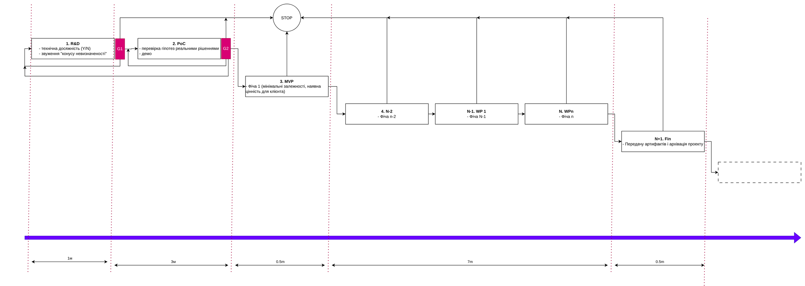
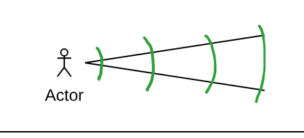
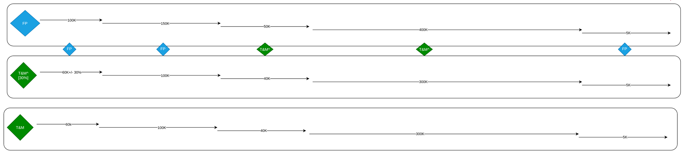
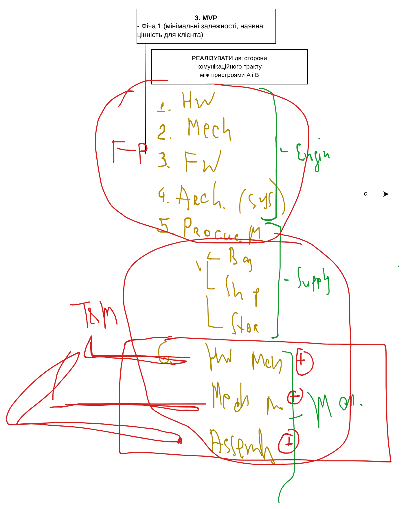

# Заняття 13. Way of work для замовника: фази, gates, конус невизначеності та моделі ціноутворення

> **27 жовтня 2026 · лекція № 8 · 1 год 26 хв 07 с.** Матеріал підготовлено за автоматичним транскриптом `IgorSikotskyKPI_L8_27102026.mp4` і схемою draw.io, яку викладач малював під час заняття. Це відредагований навчальний конспект, а не дослівна стенограма: очевидні помилки розпізнавання виправлено, терміни уніфіковано з попередніми заняттями. Усі суми й тривалості — **навчальна ілюстрація** для порівняння моделей, а не ринкові ставки. Редакторські уточнення позначено окремо.

## Місце заняття в курсі: лід став клієнтом — що далі

Після першого follow-up одразу після конференції та другої, експертної зустрічі (заняття 12) лід погоджується працювати: «я бачу, що ви розумієте нашу проблему, давайте спробуємо». Часто на цьому етапі замовник трохи розгублений: він не знає, з чого почати — «з’їсти все одразу чи по шматках». Саме тому він і шукає підрядника: у вас є експертиза, штат і досвід, тож шансів дати правильний вхід у вас більше, ніж у нього — вгадати.

Тому **частиною proposal стає модель співпраці**: як ви проведете замовника через проєкт від першого до останнього дня, що він отримуватиме і скільки це коштуватиме. Заняття розбирає цю модель у двох вимірах — **час** (фази) і **гроші** (моделі ціноутворення).

## 1. Контактна особа з боку компанії

Замовника однозначно цікавитиме, з ким він говоритиме далі. Доречно вже в пропозиції назвати контакт:

| Масштаб проєкту | Хто стає контактною особою |
| --- | --- |
| Тривалий, розгалужений, кілька команд і ролей | Постійний менеджер (PM); за потреби — додаткові ролі: Scrum Master, agile-коуч тощо |
| Компактний, до ~10 людей у команді | Один техлід, технічний менеджер або архітектор, який закриває і технічні питання, і лідерство команди |
| Короткий окремий потік робіт | Архітектор або техлід, відповідальний саме за цей стрім |

## 2. Фази проєкту та їхні результати

Викладач розбив весь таймлайн на типові фази. Для кожної фази замовнику треба чітко описати **тригер початку** і **outcome** — що саме він забере з собою по завершенні.

<figure class="diagram lecture-figure lecture-figure-wide"><figcaption class="diagram-note">Рис. 13.1. Way of work на осі часу: R&amp;D → G1 → PoC → G2 → MVP → робочі пакети → фіналізація. Зі STOP можна вийти після будь-якої фази. Схема викладача з заняття (draw.io).</figcaption></figure>

| # | Фаза | Outcome для замовника | Gate після фази |
| --- | --- | --- | --- |
| 1 | **R&D** (Research and Development) | Технічна досяжність: так чи ні, можливо з коротким коментарем «так, якщо застосувати такий підхід»; звуження конуса невизначеності | **G1** |
| 2 | **PoC** (Proof of Concept) | Гіпотези перевірено реальними компонентами й рішеннями; є демо, яке можна показати | **G2** |
| 3 | **MVP** | Фіча 1: мінімальні залежності від інших фіч і наявна цінність для клієнта | — |
| 4…N | **Робочі пакети** (Working Packages, WP 1 … WP n) | Інкрементальне зростання цінності продукту, фіча за фічею | — |
| N+1 | **Фіналізація** | Передача артефактів і архівація проєкту | — |

### R&D: чи це взагалі можливо

Стандартний вихід R&D — **технічна досяжність** (technical feasibility): чи можна реалізувати задум за поточного стану науки й техніки. Відповідь може бути дуже короткою: «так, можна» або «ні, за будь-яких розкладів не можна». Другий результат — **звуження конуса невизначеності** (див. розділ 4).

### PoC: «спаяти на колінці»

Викладач розрізнив два типи проєктів:

- **інноваційні** — з великою часткою математики, науки й пошуку; у них зазвичай є і R&D, і PoC;
- **технологічні** — наукова складова менша, але проєкт насичений готовими компонентами й фреймворками; у них **PoC є майже завжди**.

Суть PoC — не лише перевірити, що щось *могло б* працювати (як у ресерчі), а **побудувати те, що реально запрацювало**. Приклад: треба перевірити, що два пристрої можуть обмінюватися даними через оптичний канал. Будують дві примітивні макетки, ставлять на них **ті ключові компоненти, які планують використати у фінальному виробі**, пишуть простий комунікаційний протокол і дивляться: працює чи ні. **У PoC немає фіч** — перевіряється лише функціональність.

### MVP: перша фіча з цінністю

MVP (Minimum Viable Product; у курсі — «мінімально корисний продукт») — це вже продукт із користю, тобто з фічами. Першою реалізують фічу, яка:

1. має **мінімальну кількість залежностей** від інших фіч, тобто може існувати сама по собі;
2. має **мінімально достатню цінність** для клієнта, тобто вже починає відбивати інвестицію.

Підхід до MVP складніший, ніж здається: треба вибудувати всю екосистему проєкту й засетапити **ядро команди**. Формула викладача: *екосистема + ядро команди + ціль = MVP*. Саме по собі MVP грошей не генерує, але **генерує потенціал** — як потенційна енергія у фізиці: з ним замовник їздить на виставки й конференції, шукає інвесторів, споживачів і партнерів.

### Робочі пакети та фіналізація

Після MVP йде цикл робочих пакетів WP 1, WP 2 … WP n — фічі нарізають і реалізують одну за одною, нарощуючи цінність продукту. Остання фаза — **фіналізація**: передача артефактів і архівація проєкту. Підтримка, нові фічі чи інші продовження — це **предмет майбутніх домовленостей**, вони не входять у поточний workflow. Варто прямо сказати замовнику, що ви відкриті до продовження співпраці, але рухатися пропонуєте крок за кроком — «їсти борщ ложка за ложкою».

### Що замовник отримує в кінці

Мінімальний критерій успіху — **повністю завершений продукт** у тому вигляді, якого замовник хотів від початку. Але повний результат ширший: замовник захоче отримати всі артефакти, напрацьовані під час роботи, щоб відтворити продукт або продовжити розробку — з вами чи з іншою командою:

- продукт і технічна документація до нього;
- документація з розробки, потрібна для продовження робіт без вас.

## 3. Gates: умови переходу між фазами

Після R&D і після PoC стоять **gates** (G1, G2). Gate — це умова переходу, у якої є **три валідні результати**:

1. **Пройшли** — рухаємося до наступної фази.
2. **Не пройшли, шукаємо далі** — новий раунд ресерчу або PoC на інших компонентах, якщо замовник готовий інвестувати час і гроші. Результат PoC може виявитися настільки «крамольним», що відкине проєкт аж на початок і змусить переоцінити весь ресерч.
3. **Не пройшли, зупиняємося** — hard stop: виходимо з проєкту.

Після MVP gates уже немає: далі йде послідовність фіч. Проте **замовник може зупинитися після будь-якої фази** — це його гроші і його фінансове право.

Пояснений таким чином workflow — R&D, PoC, два gates, MVP, цикл фіч і фіналізація — для замовника перестає бути «темним лісом». Він бачить, що ви професійно ставитеся до ризиків і керуєте ними. Тому цю схему варто показати **вже на першій зустрічі щодо proposal**.

## 4. Конус невизначеності

<figure class="diagram lecture-figure lecture-figure-small"><figcaption class="diagram-note">Рис. 13.2. Конус невизначеності: що далі в часі подія, то ширший діапазон оцінки. Ескіз викладача (draw.io).</figcaption></figure>

Уявіть, що ви стоїте на осі часу й дивитеся в майбутнє. На горизонті одного місяця ви досить чітко бачите, як іде проєкт і які будуть витрати — діапазон невизначеності малий. На горизонті чотирьох місяців він уже значно ширший: ви робите більше **припущень** (assumptions). Що далі в часі, то менша точність оцінки — і за термінами, і за грошима.

R&D дає змогу «перенести» вершину конуса вперед: ви пройшли частину шляху, знання про проєкт зросли, і тепер будуєте конус уже з нової точки — з меншою похибкою щодо того, у що проєкт обійдеться в кінці.

> **Редакторське уточнення.** Поняття сходить до праць Баррі Боема (1981); назву «конус невизначеності» популяризував Стів Макконнелл. У класичному варіанті на стадії початкової концепції оцінка може відхилятися приблизно від 0,25× до 4× від фактичного значення, а конус звужується лише тоді, коли команда ухвалює рішення, що знімають невизначеність. Звуження не відбувається «саме собою» з плином часу — саме тому R&D і PoC такі цінні.

## 5. Грубий таймлайн для замовника

Далі на фази накладаються орієнтовні часові рамки. Викладач поки задав їх умовно; звідки беруться такі оцінки, курс розбере окремо.

| Фаза | Тривалість | Наростаючим підсумком |
| --- | --- | --- |
| R&D | 1 міс. | 1 міс. |
| PoC | 3 міс. (за умови проходження gate) | 4 міс. |
| MVP | 0,5 міс. (≈ 2 тижні) | 4,5 міс. — перша цінність, яку вже можна продавати |
| Робочі пакети (усі фічі) | 7 міс. | 11,5 міс. |
| Фіналізація (передача артефактів) | 0,5 міс. | 12 міс. |

Важливо забезпечити **пряму комунікацію**: замовник має прийняти, що **gates змінюють будь-які правила** і можуть переглянути весь план. Ваше завдання — переконати його в доцільності кожного переходу, але не обманювати. Детальні естімейти фіч можна надати окремо, якщо замовник попросить; викладач радить себе убезпечувати й не деталізувати зайвого на цьому етапі.

## 6. Ціна: Fixed Price, Time & Material і T&M «з шапочкою»

Замовник уже розуміє, *що* і *коли* отримає. Тепер йому треба розуміти, *скільки* це коштуватиме. Той самий way of work описують кількома моделями.

<figure class="diagram lecture-figure lecture-figure-wide"><figcaption class="diagram-note">Рис. 13.3. Той самий таймлайн у трьох моделях ціни. Ромби між смугами — комбінована модель: FP для R&amp;D і PoC, T&amp;M^ для MVP і робочих пакетів, FP для фіналізації. Схема викладача (draw.io).</figcaption></figure>

| Фаза | Fixed Price (FP) | T&M з верхньою межею (T&M^) | Комбінована модель |
| --- | --- | --- | --- |
| R&D | 100K | 60K ± 30 % | FP |
| PoC | 150K | 100K | FP |
| MVP | 50K | 40K | T&M^ |
| Робочі пакети | 400K | 300K | T&M^ |
| Фіналізація | 5K | 5K | FP |
| **Разом** | **705K** | **505K** (оцінка) | — |

Суми ілюстративні; на занятті викладач називав їх то в доларах, то в євро. Фіналізацію подано майже за собівартістю доставки, як «шалену знижку» для прозорості.

### Чому ціна за одне й те саме так відрізняється

Ключова різниця між моделями — **на чиєму боці ризики**.

- **Fixed Price**: ризики на боці виконавця. Ми розпланували, наберемо команду, відповідаємо за інженерів, менеджмент, доставку, вендорів, заводи й будь-які затримки — замовника це не обходить. Він відраховує 100K і чекає місяць. Якщо не встигли — штрафи. **Ця відповідальність і коштує різницю**: у прикладі R&D це 40K (100K проти 60K).
- **Time & Material**: замовник платить за фактично витрачений час і матеріали; ризик недооцінки — на ньому.

Викладач відкрив «таємницю» сервісного бізнесу: інженер отримує **однакову зарплату** незалежно від моделі контракту — різниться лише **маржа** компанії. Маржа — це різниця між тим, що компанія платить інженеру, і тим, що бере з клієнта за його час. З неї утримуються офіси, адміністрація, юристи, фінансовий відділ, сервісні підрозділи — десятки, сотні й тисячі людей, які супроводжують проєкти. У прикладі реальна інженерна вартість R&D — приблизно 10–30K; у T&M компанія просить 60K, у FP — 100K, і частина цієї різниці існує саме для того, щоб покрити ризики, якщо щось піде не так.

### Які ризики лишаються у виконавця за T&M

На занятті цю тему обговорили зі студентами:

| Сценарій | Чий ризик за T&M | Наслідок для виконавця |
| --- | --- | --- |
| Ключовий інженер захворів, команда не вклалася в терміни | Замовника | Прямих втрат немає |
| Через неякісну оцінку вартість проєкту зростає | До певної межі — замовника; виконавець навіть заробляє більше | Якщо вартість зросла кратно — замовник іде, компанія **недоотримує очікуваний прибуток** |
| Команда не впоралася із задачею | Спершу замовника | Замовник іде й більше не повертається — **репутаційний удар** |

Репутаційний ризик найболючіший у роботі з великими замовниками (у прикладах лекції — Volkswagen Group, SpaceX): проваливши проєкт на 100 тисяч, можна потрапити в «чорний список» і назавжди втратити значно більші гроші.

За **Fixed Price** у разі провалу компанія отримує всі три удари одночасно:

1. недоотриманий прибуток;
2. репутаційну втрату;
3. **штраф** за договором — зазвичай у кілька разів більший за вартість фази (ілюстрація викладача: близько 400K штрафу за фазу вартістю 100K).

Тому FP подекуди вдвічі дорожчий за T&M, і йти в нього варто **лише тоді, коли ви абсолютно впевнені** в тому, що робите.

### Два різновиди T&M

| Модель | Що обіцяє виконавець | Відповідальність |
| --- | --- | --- |
| **T&M** (без межі) | Оцінку фази, наприклад 60K | Жодної: «оцінили 60K, не влучили — вибачте» |
| **T&M^** («з шапочкою», з верхньою межею) | Оцінку плюс допуск на дрейф ринку; у практиці викладача — **±30 %** | Репутаційна: ви зобов’язуєтеся вкластися в межі допуску |

Логіка T&M^: «за нашими оцінками фаза R&D коштуватиме 60K; може вийти 10K, може 60K, але ринок нестабільний, тому ми закладаємо 30 % похибки й точно вкладемося в цей коридор».

> **Редакторське уточнення.** У міжнародній практиці таку модель називають *capped T&M* або *T&M with a not-to-exceed (NTE) limit*. Конкретний відсоток допуску — домовленість сторін; 30 % — особиста практика викладача.

## 7. Комбінована модель за фазами

Моделі не обов’язково застосовувати до всього проєкту одразу. Викладач запропонував **підлаштовувати модель під ризик кожної фази**:

| Фаза | Модель | Чому |
| --- | --- | --- |
| R&D | FP | Фаза закінчується gate, який добре захищає |
| PoC | FP | PoC сам по собі «стрьомний» — гіпотеза може не стрельнути. Але в кінці стоїть gate, тому **успішним є будь-який результат**: «не відпрацювало» — теж відповідь. Тож можна спробувати «розкошелити» клієнта на верхню межу костів, якщо він погодиться |
| MVP | T&M^ | Embedded-проєкт: багато залежностей від чужих виробництв і поштових сервісів, які шалено затримують доставки |
| Робочі пакети | T&M^ | Та сама «нерозбериха» залежностей |
| Фіналізація | FP | Артефакти — ваші, ви точно знаєте, що вони будуть у наявності |

Виходить «хитра» модель: FP там, де вас захищають gates; T&M^ там, де багато невизначеності; FP на виході, де все під вашим контролем.

## 8. Коли замовник наполягає на Fixed Price усюди

Буває, що замовник хоче FP на все, і без гнучкості ви його втратите. Другий рівень балансування — **розкласти фазу за функціями**. Викладач узяв фазу MVP і подивився, що в неї «під капотом».

**Ціль MVP у навчальному прикладі:** реалізувати дві сторони комунікаційного тракту між двома пристроями — умовно A і B. Кожен із них має власну електроніку, корпус і прошивку, а дані між ними передаються радіоканалом. У першому MVP треба налагодити зв’язок між цими двома пристроями.

<figure class="diagram lecture-figure"><figcaption class="diagram-note">Рис. 13.4. Що «під капотом» MVP: Engineering (HW, Mech, FW, System Architect) — FP; Supply (Buy, Ship, Store) і Manufacturing (HW, Mech, Assembly) — T&amp;M. Схема викладача (draw.io).</figcaption></figure>

| Група | Ролі та функції | Модель |
| --- | --- | --- |
| **Engineering** | Hardware (електроніка), Mechanics (корпуси для обох пристроїв), Firmware (мікроконтролери з обох боків і протокол), System Architect (поєднує HW, Mech і SW: як це виглядає й взаємодіє) | **FP** |
| **Supply** | Procurement Manager: закупівля (buy), доставка (ship), зберігання на складі (store), взаємодія з поштовими сервісами | **T&M** |
| **Manufacturing** | Виробництво електроніки, виробництво механіки, збірка (assembly) | **T&M** |

Пояснення замовнику звучить так: «Раз ти дуже хочеш Fixed Price, ми йдемо назустріч: увесь **інженеринг** — fixed price. Ціна й таймлайн інженерної частини будуть рівно такими, як ми домовимося; якщо вийдемо за межі — платимо з власної кишені. А supply і manufacturing — time and material». Причина проста: компанія **не виробляє**, вона розробляє й надає контроль виробництва. Електроніку робить, наприклад, китайський підрядник, механіку — заводи в Білій Церкві, Харкові, Луцьку, збірку — ще інший завод. Компанія передає креслення, а її інженер здійснює технічний нагляд. Ці підрядники можуть змінити ціну, і нести за них відповідальність компанія не хоче.

## Практичні висновки

- Модель співпраці — обов’язкова частина proposal: замовник має бачити фази, їхні тригери й outcomes.
- R&D відповідає на питання «чи можливо», PoC — «чи працює на реальних компонентах», MVP — «чи є перша цінність».
- Gates після R&D і PoC мають три валідні результати: далі, повторити пошук, стоп.
- Замовник може зупинитися після будь-якої фази; продовження після фіналізації — предмет нових домовленостей.
- Різниця між FP і T&M — у розподілі ризиків; ціна FP включає вартість цих ризиків.
- За T&M у виконавця лишаються недоотриманий прибуток і репутація; за FP до них додається штраф.
- T&M^ з допуском (наприклад, ±30 %) — компроміс між гнучкістю та відповідальністю.
- Модель можна змішувати за фазами (FP–FP–T&M^–T&M^–FP) і за функціями (інженеринг FP, постачання й виробництво T&M).

## Питання для самоперевірки

- Чому замовнику потрібна модель співпраці вже в proposal?
- Хто має бути контактною особою в компактному і в розгалуженому проєкті?
- Чим outcome фази R&D відрізняється від outcome PoC?
- Чим інноваційний проєкт відрізняється від технологічного з погляду фаз R&D і PoC?
- Які дві умови має задовольняти перша фіча MVP?
- Які три результати можливі на gate?
- Що таке конус невизначеності і як R&D впливає на нього?
- Чому Fixed Price дорожчий за Time & Material за той самий обсяг робіт?
- Які ризики лишаються у виконавця за моделі T&M?
- Чим T&M відрізняється від T&M з верхньою межею?
- Чому PoC можна брати у Fixed Price, хоча гіпотеза може не підтвердитися?
- Як розкласти фазу на частини, щоб піти назустріч замовнику, який хоче FP усюди?

## Що заплановано далі

Викладач анонсував: «залізти в прямокутнички» — розібрати, звідки беруться тривалості фаз (1, 3, 0,5, 7 місяців) і чому перші дві фази можуть бути Fixed Price, а третя й четверта — ні. Частину цього розібрано вже на наступному занятті 28 жовтня. Це **оголошений план**.

## Матеріали заняття

- Схема draw.io з заняття: [завантажити .drawio](../source-materials/2026-10-27-way-of-work-pricing.drawio) (відкривається в diagrams.net / draw.io).

## Перевірені посилання

- S. McConnell. The Cone of Uncertainty (Construx, white paper): https://www.construx.com/wp-content/uploads/2019/02/CxWhitePaper_ConeOfUncertainty.pdf
