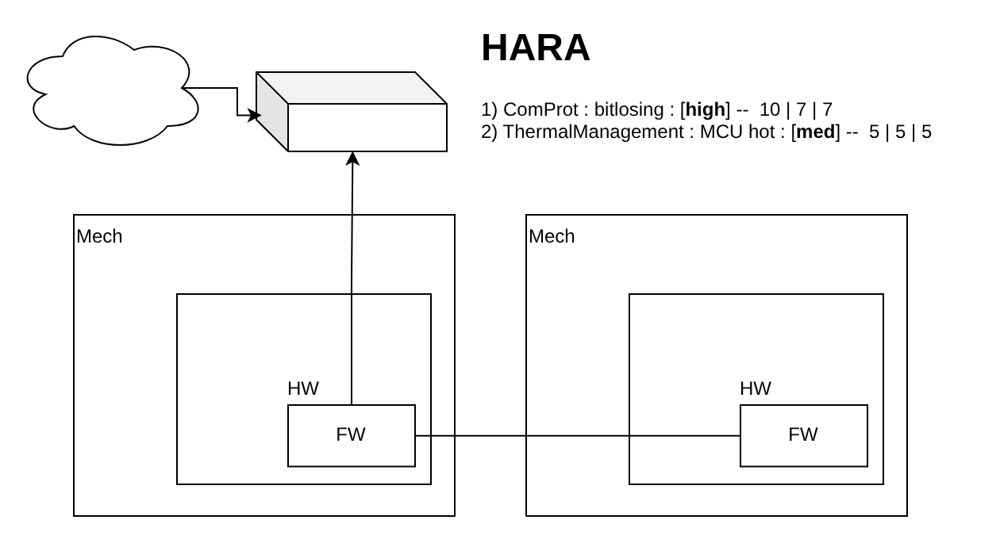
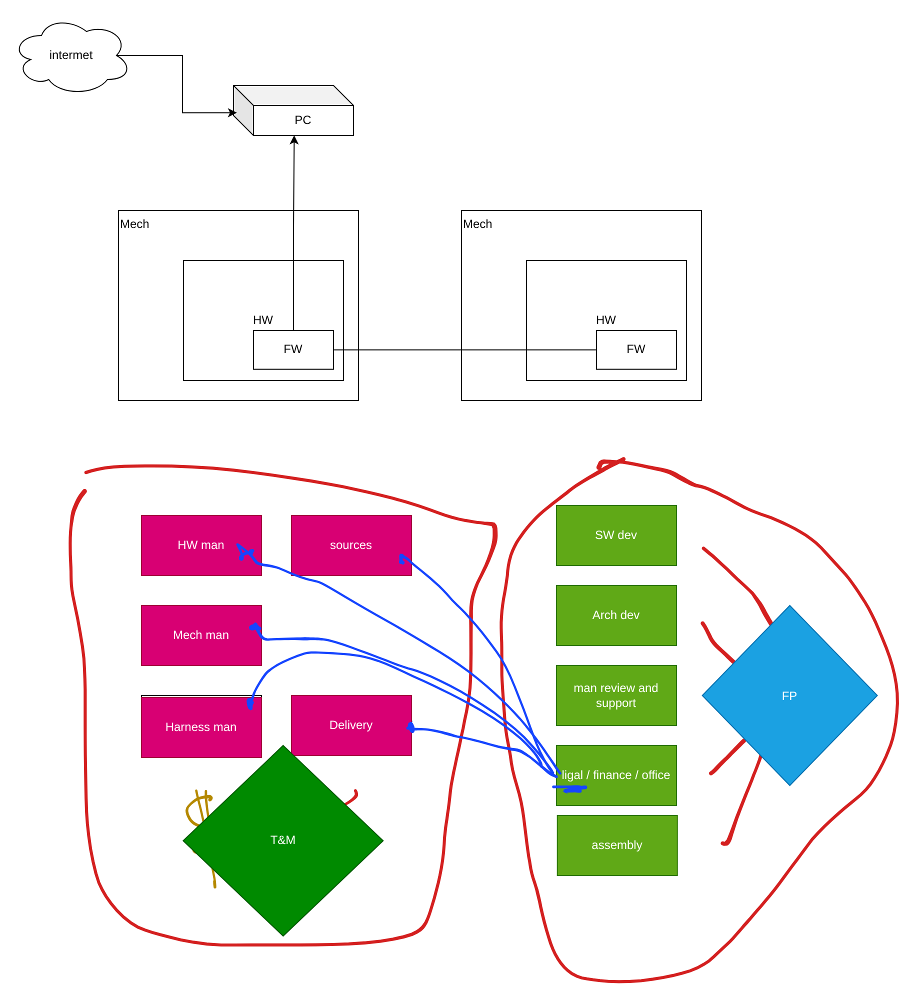
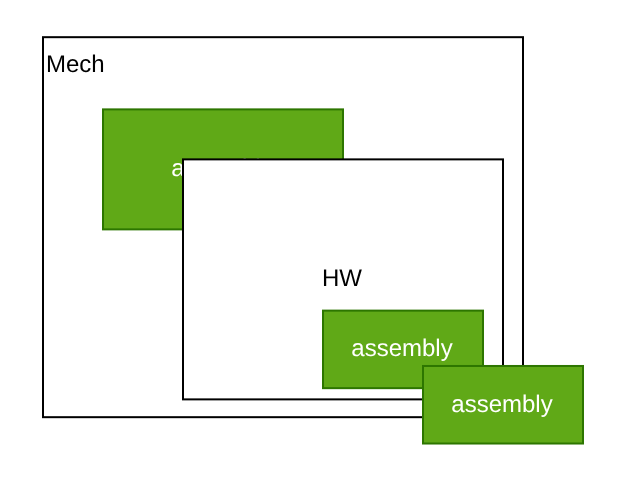
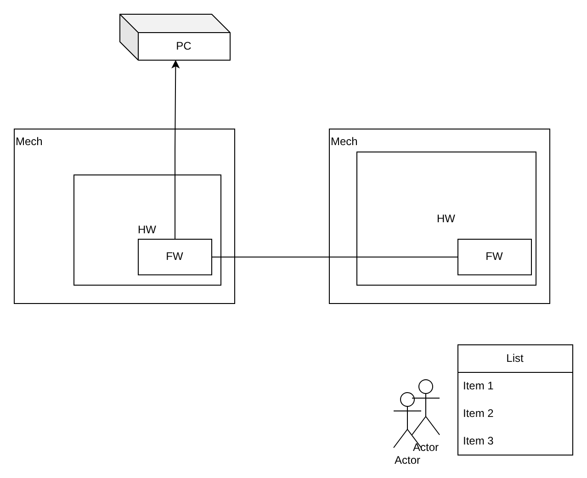

# Заняття 14. HARA для PoC, гібридний контракт і детальний план першого епіку

> **28 жовтня 2026 · практичне заняття · 1 год 34 хв.** Матеріал підготовлено за автоматичним транскриптом `IgorSikorskyKPI_28102026.mp4`, схемою draw.io та Excel-планом, які викладач створював під час заняття. Це відредагований навчальний конспект, а не дослівна стенограма: очевидні помилки розпізнавання виправлено, терміни уніфіковано з попередніми заняттями. Досвід роботи з виробниками й постачальниками — **особиста практика викладача**, подана без назв компаній. Редакторські уточнення позначено окремо.

## 0. Організаційне

- Заняття записується; відео й автотранскрипт доступні студентам для конспекту.
- Робочий файл схем викладач вивантажив на Google Drive; після завершення курсу матеріали буде розміщено на його сервері з посиланням на сайті.
- За підсумками курсу планується методичний посібник.
- Нагадування про безпеку: у разі повітряної тривоги — бути обачними й подбати про власну безпеку.

## 1. Повторення: фази, gates і конус невизначеності

Заняття 13 описало, як представити замовнику way of work: розбити проєкт на фази 1, 2, 3 … N, сказати про відкритість до продовження (підтримка, ліквідація тощо) і чесно показати **щонайменше два gates**. Gate — точка виходу:

- R&D завершилося успішно — йдемо на PoC;
- неуспішно — gate дає змогу швидко «одропнутися» на ранній стадії з мінімальними втратами часу й грошей **для обох сторін**;
- або знайти іншу концепцію й повернутися на початок зі спробою № 2, № 3.

Залежно від типу проєкту варто як мінімум не забувати про R&D і PoC. R&D перевіряє **технічну досяжність** за поточного стану науки й техніки: якщо ні — треба шукати іншу науку чи техніку або чекати, поки вони дозріють. R&D також **звужує конус невизначеності**: що далі в часі подія, то більше припущень і то важче оцінити, що ви зможете реалізувати, скільки це коштуватиме й скільки займе. Це теж треба прокомунікувати замовнику на етапі R&D.

## 2. Що дає PoC: правильний вибір інструмента

Після успішного R&D запропонуйте замовнику Proof of Concept. Акцент у PoC — не на красі й не на фіналізації виробу, а на перевірці вибору:

| Що перевіряє PoC | Приклад |
| --- | --- |
| Компонентна база | Обраний чіп справді працює з AI; DSP встигає без надмірних затримок обробляти 10 відеопотоків з 10 камер паралельно |
| Фреймворк | Чи є в ньому достатній tooling для задачі |
| Мова програмування | Чи достатньо вона функціонально безпечна, чи є під неї підтримка |
| Операційна система | Чи є під неї нормальний компілятор — інакше доведеться переписувати тонни вже готового коду |

Ризик пропуску PoC колосальний: ви закладете чіп, закупите його, розробите під нього електроніку, корпус і систему охолодження, а він «не потягне». PoC коштує грошей, але **забирає великі ризики майбутнього у виборі інструмента**.

## 3. Що саме брати в PoC: HARA

Проєкт може бути великим: власне hardware (друковані плати), firmware на ньому, механіка (корпус), у який усе вбудовано, комунікаційний протокол між пристроями, десктопна частина, cloud. Навчальна топологія: два фізичні пристрої у двох корпусах, на кожному — власна електроніка з чіпами й firmware; між ними — протокол; один firmware є master, а окремий комп’ютер працює як шлюз і «прокидає» дані з cloud.

<figure class="diagram lecture-figure"><figcaption class="diagram-note">Рис. 14.1. Навчальна топологія й короткий HARA до неї: втрата бітів у комунікаційному протоколі — high (10 | 7 | 7), перегрів MCU в корпусі — medium (5 | 5 | 5). Схема викладача (draw.io).</figcaption></figure>

У PoC беруть **найбільш «стрьомне»** — те, де можна «дати в штангу». Щоб визначити, що саме, проводять вправу **HARA — Hazard Analysis and Risk Assessment** (аналіз загроз і оцінка ризиків). Усі інженери збираються разом (бажано офлайн) і аналізують, що може статися із системою: де ви не впевнені, чого раніше не робили, де будете першовідкривачами.

Приклад із заняття:

| # | Об’єкт | Загроза | Оцінки | Рівень |
| --- | --- | --- | --- | --- |
| 1 | Комунікаційний протокол | Втрата бітів (bit losing); відмова протоколу «вбиває все» | severity 10, частота 7 (статистика й досвід інженерів), impact 7 | **high** |
| 2 | Термоменеджмент корпусу | Механік не впевнений, що «гарячий» MCU не перегріватиметься | 5, 5, 5 | **medium** |

Із результатами HARA ви йдете до замовника: «У межах PoC ми хотіли б дослідити ці два питання — вони видаються найнебезпечнішими», і аргументуєте це слайдами й таблицею. Реакція замовника залежить від його ситуації:

| Замовник | Що дозволить дослідити в PoC |
| --- | --- |
| Має фінансові клопоти | Лише ризики рівня high |
| Збалансований | High і medium |
| «Адекватний» — хоче йти далі без ризиків | High, medium і low |

## 4. Як виглядає таблиця HARA

Викладач показав типову структуру такого аналізу (знайдений приклад, за його словами, ближчий до TARA — аналізу загроз кібербезпеки, але структура та сама):

| Поле | Зміст |
| --- | --- |
| Ідентифікатор | Номер загрози |
| Опис | Що відбулося і в якій функціональності або компоненті (комунікація, механіка…) |
| Контроль | Як ризик контролюватиметься: автоматичне виправлення, дія оператора або прийняття ризику |
| Severity | Сила впливу |
| Probability | Імовірність того, що це станеться |
| Рівень ризику | Добуток severity × probability; ви вводите власні межі low / medium / high |
| Action plan | Що робитимемо, щоб зменшити ризик: дослідити, змінити, перебудувати — або нічого, якщо ризик приймається |

High треба обов’язково аналізувати; щодо medium і low ви свідомо вирішуєте, що робити, зважаючи на ймовірність. Два приклади:

- **Падіння метеорита**: наслідки дуже серйозні, але ймовірність дуже низька — ризик класифікують як низький.
- **Пілот засинає за штурвалом** із вимкненим автопілотом: важкі умови роботи роблять імовірність досить високою, наслідки — серйозні, тож ризик дуже високий.

> **Редакторське уточнення щодо прикладу з пілотами.** Деталі, які викладач навів з пам’яті (Air France, переліт Парижа «майже до Польщі»), не вдалося підтвердити. Задокументовані випадки, коли засинали обидва пілоти: рейс Ethiopian Airlines ET343 Хартум — Аддис-Абеба (серпень 2022 року) пролетів аеропорт призначення, і екіпаж прокинувся від сигналу автопілота; рейс Batik Air Кендарі — Джакарта (січень 2024 року) — за звітом індонезійського розслідування обидва пілоти спали близько 28 хвилин, і літак відхилився від курсу. Суть прикладу це не змінює: висока ймовірність × важкі наслідки = високий ризик.

> **Редакторське уточнення щодо методики.** Числова оцінка «severity × probability», яку використав викладач, — спрощена матриця ризиків у дусі FMEA, зручна для внутрішнього пріоритезування PoC. Формальний HARA за **ISO 26262-3** класифікує кожну небезпечну подію за трьома параметрами — **Severity (S0–S3), Exposure (E0–E4), Controllability (C0–C3)** — і визначає рівень **ASIL A–D** або QM. Аналіз загроз кібербезпеки **TARA** описано в **ISO/SAE 21434**. Якщо проєкт підпадає під ці стандарти, внутрішню таблицю для PoC не слід видавати замовнику за формальний HARA чи TARA.

## 5. Що робити з результатом PoC

Ризики, визначені в HARA (у прикладі — протокол і перегрів корпусу), стають **об’єктами дослідження** в PoC. Якщо проблема підтвердилася, її треба розв’язати — як мінімум знайти шлях вирішення:

- **шлях знайдено** — це достатня умова переходу далі по проєкту;
- **шлях не знайдено** — зупиняємо проєкт або повторюємо дослідження.

Далі проєкт рухається по фічах, одна за одною, аж до кінця.

## 6. Гібридний контракт: що робимо ми, а що вендори

На занятті 13 розглядали Fixed Price, Time & Material і T&M з верхньою межею, а також їхнє поєднання за фазами. Практика показує ще один варіант — поділ **за відповідальністю**. Повернімося до топології з двома пристроями.

<figure class="diagram lecture-figure"><figcaption class="diagram-note">Рис. 14.2. Поділ відповідальності: ліворуч — зовнішні вендори (T&amp;M), праворуч — власний інженерний сервіс (FP). Сині стрілки — legal, який веде претензійну роботу з кожним вендором. Схема викладача (draw.io).</figcaption></figure>

| Хто | Функції | Модель |
| --- | --- | --- |
| **Ми** (in-house) | Software development; architecture; manufacturing review and support — технічний нагляд за виробництвом; legal / finance / office management; assembly (див. розділ 7) | **FP** |
| **Вендори** | Виробництво hardware; виробництво механіки (корпуси); виробництво жгутів (harness); постачання компонентів (sources); доставка | **T&M** |

Ми спроєктуємо механіку, розробимо й заревʼюємо hardware, наші механік і електронік спроєктують жгут — але **виготовляти не будемо**: немає заводу, компетенцій, техніків, які обжмуть кабелі, вкладуть їх в ізолятор і кабель-канали. Виготовлення передають зовнішнім організаціям. **Вендор** — інша організація, яка за гроші надає вам сервіс: завод, постачальник або перевізник.

### Чому чистий Fixed Price на все — постріл собі в ногу

Чистий FP на все разом означає, що замовник хоче «сходити в магазин і купити відро картоплі»: заплатити, почекати й отримати готовий виріб. Але вендори вам не підконтрольні: вони можуть змінити **час, якість і ціну**. Викладач навів власну практику:

| Ланка | Що відбувається на практиці |
| --- | --- |
| Електроніка | Виготовлення зазвичай замовляють у Китаї, бо дешевше. Останнім часом виробники обмежують замовлення з України: друковані плати виготовляють, але компоненти не запаюють. З’явився ще один вендор — постачальник компонентів (мікросхем, транзисторів, конекторів, пасивних елементів): більше грошей, часу й ризиків |
| Механіка | Виробничі потужності в Білій Церкві, Харкові, Києві; питання до якості й термінів. Старий якісний і пунктуальний виробник підняв ціну в півтора раза — і фактично вибув із гри |
| Жгути | Виготовлення в Кам’янці-Подільському; останнім часом виникли питання до якості |
| Доставка | В Україні великі й непрогнозовані затримки |
| Компоненти | Можуть просто зникнути з ринку; дефіцит мікроконтролерів і мікропроцесорів — замовляти доводиться за місяць-два до потреби |

Усі ці ланки можуть «грати» одночасно, а поштовий сервіс множить усе на власний коефіцієнт затримок і цін. І найгірше — це **фізичний виріб**. Якщо під час вхідного контролю виявили брак, переробка одразу подвоює час доставки. Якщо вендор відмовиться переробляти — підключається legal, а це знову час. Окремо викладач підкреслив, що виріб рідко створюється в одній країні, тому війна й обмеження десь у світі завжди впливають на ланцюг постачання.

Висновок: **Fixed Price на виробничу частину в сучасних умовах — не лише України, а й Європи — для будь-якого embedded-проєкту означає вистрілити собі в ногу.**

### Коли FP на вендорську частину все ж можливий

Лише за умови, що у вас є підтверджені legal договори з доставкою, постачальником компонентів і виробниками hardware, механіки та жгутів. Тоді, якщо вендор затягує, корпоративні юристи йдуть із ним у суд, і вендор компенсує втрати, передбачені вашим FP-договором із замовником. Але сучасні виробники добре розуміють ці ризики й майже напевно такий договір не підпишуть. А якщо підпишуть — «взвинтять» ціну. Ви теж піднімете свою, а замовник або підніме ціну власного продукту, або відмовиться від вас.

### Рекомендований поділ

Переконайте замовника розбити модель співпраці на дві групи:

- **in-house сервіс** — software, architecture, manufacturing review, legal, finance, office management, assembly — за **фіксованим часом і фіксованою ціною**;
- **закупівля компонентів, виробництво електроніки, механіки й жгутів, доставка** — за **time and material**.

Тоді, як кажуть, «і вовки ситі, і кози цілі». Ваш ризик і ризик проєкту — «рідні брати»: якщо щось «фейлиться», страждають обидві сторони. Пояснивши це, ви зазвичай знайдете розуміння в замовника, якщо він «у своєму розумі». Сучасні клієнти з такою комбінованою моделлю непогано знайомі.

У проєкті тепер **два запобіжники**: цей поділ відповідальності та gates після ризикованих фаз. Разом вони тримають у балансі навантаження й ризики для вас, клієнта й вендорів.

## 7. Дилема assembly: віддати чи тримати в себе

<figure class="diagram lecture-figure lecture-figure-small"><figcaption class="diagram-note">Рис. 14.3. Три рівні збірки: механіка, друкована плата (PCBA) і виріб у цілому. Схема викладача (draw.io).</figcaption></figure>

**Варіант 1: збірку робить завод механіки.** Припустімо, механічний виріб складається приблизно зі 120 елементів: передня частина, основа, рама, верхній корпус, внутрішні елементи жорсткості. Ви передаєте заводу конструкторську документацію, після чого технолог заводу й ваш інженер погоджують техпроцес: гнуття, лазерне різання, фрезерування тощо. Кожна машина працює трохи інакше: два ідентичні гнучкі верстати гнуть по-різному, фарбувальна машина дає трохи інший відтінок. Тому інженер і технолог мають не просто обмінятися специфікацією, а **проговорити**, що саме зробити, щоб виріб гарантовано зібрався й запрацював. Викладач пожартував про «козу» — «конструкторську записку», фактично специфікацію під конкретний завод. Після виготовлення ваш інженер надає **складальну документацію** (інструкцію зі збирання), і завод збирає виріб.

- Плюс: ви отримуєте готовий механічний виріб.
- Мінус: ціна суттєво зростає — для виробника це додаткові зобов’язання, люди і складальний цех, якого в нього може й не бути.

**Але збірка має три рівні:**

1. **Збірка механіки** — з окремих дверцят, рам тощо.
2. **Збірка плати** — компоненти від постачальника розпаюють на «голу» PCB й отримують **PCBA** (PCB assembly).
3. **Збірка виробу** — PCBA встановлюють у механіку; після цього в готовий виріб завантажують firmware.

Саме ця багатоступеневість спонукала викладача створити **власну роль assembly** — окремий складальний цех. Його закриває **технік (technician)** з двома компетенціями: механічна збірка й збірка/монтаж PCBA. «Якщо функцію використовують двічі, логічно зробити з неї окрему функцію».

Якщо для техніка організовано робоче місце, склад і адекватні інструменти — тобто він почувається комфортно, а не «білою вороною в IT-офісі», — він може взяти на себе й **виготовлення значної частини жгутів**: закупити конектори, провід, ізолятори й зібрати жгути за вашим проєктом. Отже, власний assembly:

- суттєво зменшує ризик помилок на етапі збірки механіки;
- відкриває можливість перетягнути до себе harness manufacturing.

Навіщо це студентам-програмістам? Бо ви розробляєте **систему**: софт вбудовано в чіп, чіп — у плату, плата — в корпус. Ніхто з вас, імовірно, не супроводжуватиме виробництво особисто, але розуміти, як збудовано цей процес, дуже важливо.

## 8. Приклад: два пристрої й робоче місце оператора

<figure class="diagram lecture-figure"><figcaption class="diagram-note">Рис. 14.4. Навчальний проєкт: пристрій A, пристрій B і PC зі списком подій (Item 1, 2, 3) для операторів. Схема викладача (draw.io).</figcaption></figure>

Умовний замовник хоче систему з трьох частин:

- **пристрій A** — реальний виріб із кріпленням, електронікою і кодом; через сенсори визначає, що його встановлено й увімкнено, і передає свій стан радіоканалом;
- **пристрій B** — приймає цей потік даних і, розпізнавши потрібну подію, передає її на комп’ютер операторів;
- **комп’ютер операторів** показує, яку дію виконувати зараз: Item 1, Item 2, Item 3. Цього достатньо: побачивши Item 1, оператори виконують відповідну дію.

Замовнику «горить», тож перший крок — **детальне планування**. Найкращий інструмент для цього, за досвідом викладача, — Excel.

## 9. Детальний план EPIC 1

Нижче — часова діаграма розбиття проєкту на фази, яку викладач будував у реальному часі. Gates G1–G4 стоять там, де результат може зупинити проєкт.

| № | Етап | Gate | Що відбувається |
| --- | --- | --- | --- |
| 1 | Збір інформації про об’єкт і середовище (≈ R&D) | **G1** | Які радіоканали можна використати на місці експлуатації й сертифікувати; робота в шумах; які частоти вже зайняті (щоб уникнути інтерференції); температури, рівень забруднення, живлення. «Більше питань, ніж відповідей». Без цього немає предметної області. Середовище може виявитися настільки поганим, що проєкт далі не піде |
| 2 | Розробка й ухвалення вимог до системи (system requirements) | **G2** | Без вимог систему не описати. Доки вимоги не ухвалено із замовником, проєктувати далі не можна — він може захотіти інше |
| 3 | Архітектурний опис системи | — | Декомпозиція: які підсистеми, hardware, чіпи. Реальний view на проєкт |
| 4 | Аналіз ризиків (HARA, за потреби TARA) | — | HARA — функціональна безпека, TARA — кібербезпека |
| 5 | PoC за ризиками з HARA/TARA | **G3** | Окремий R&D тут не потрібен: етап 1 уже є дослідженням. PoC може сказати: «не лізьте туди» — наприклад, електромагнітна інтерференція «валить» усе |
| 6 | MVP | — | Мінімальна функція: підтвердити, що пристрої A і B бачать один одного, засвітити індикатор. Без корпусу, «примотано скотчем». Продає ваш сервіс |
| 7 | Деталізація вимог до SW, механіки та HW | — | Тепер зрозуміло, про що йдеться: є вимоги, архітектура, перевірені ризики й демо |
| 8 | Оцінка завантаженості HW (ресурси для FW) | — | Який чіп, яка комунікація, оптика чи радіо потрібні, щоб firmware працював згідно з вимогами |
| 9 | Пошук компонентної бази на ринку (HW) | **G4** | Чіп, RAM, елементи живлення, радіоінтерфейс — чи вони реально є і чи можна їх купити. Без закупівлі подальшого розвитку немає |
| 10 | Модель / віртуалізація: SW mockup (застосунок) | — | Імітатори пристроїв A і B, їхньої механіки та радіоканалу. Проєкт без заліза, до інтеграції. Методологія — ваш вибір (класичний підхід, TDD) |
| 11 | Hardware development: schematic, PCB, BoM | — | Паралельно з етапом 10. Результат: схема, PCB, 3D-модель і перелік компонентів із цінами й кількістю |
| 12 | Review HW | — | Інший інженер перевіряє hardware. **Обов’язкова стадія** |
| 13 | Review HW by FW | — | Firmware-інженер перевіряє, чи функціонал «ляже» на це залізо |
| 14 | All hands (HW) | — | Зустріч із замовником: чи це те бачення, яке він хоче |
| 15 | Mechanical development (вимоги + STEP-моделі HW) | — | Механік проєктує корпус на основі вимог і 3D-моделей плат від hardware-інженера. У виробництво ще нічого не пішло |
| 16 | Review механіки by HW | — | Hardware-інженер перевіряє механіку |
| 17 | Rework (HW / Mech) | — | Буде завжди: плата не стане в корпус або стане, але грітиметься |
| 18 | All hands (HW + Mech) | — | Демо для всіх стейкхолдерів: менеджмент, замовник, інженери |
| 19 | Manufacturing (HW і Mech) | — | Обидві частини йдуть на виробництво |
| 20 | Manufacturing support (HW і Mech) | — | Довгий «мутний» час постійної комунікації інженерів із виробниками |
| 21 | Procurement і доставка компонентів | — | Час виробництва використовують для закупівлі стандартних деталей механіки (болти, гайки, шайби, гровери, ніжки, ручки) й електроніки (наприклад, Mouser, DigiKey): закупівля, розмитнення, доставка, зберігання на складі чи в сейфі офісу. Відповідає **Procurement Manager** |
| 22 | Assembly (Mech) | — | Механіка приходить раніше; збирає технік |
| 23 | Review (Mech) | — | Перевірка зібраної механіки |
| 24 | Rework (Mech) | — | Закладайте одразу: assembly і rework ідуть разом |
| 25 | Assembly (HW) | — | Монтаж плат |
| 26 | Review (HW) | — | Перевірка зібраних плат |
| 27 | Rework (HW) | — | На першій ітерації помилки виправляють на місці: ріжуть доріжки, напаюють перемички |
| 28 | FW: фіналізація й завантаження | — | Код, «наклепаний» на моделі (етап 10), завершують на реальному залізі |
| 29 | FW: тестування | — | Тестування на реальному залізі |

> **Редакторське уточнення.** У робочому Excel-файлі рядки 23–24 і 26–27 підписано як «review / Review (Mech)» та «review / Review (HW)». За поясненням викладача на занятті, послідовність така: збірка → review → rework, тому в таблиці вони подані як Review і Rework.

**Орієнтовні строки виробництва** з досвіду викладача:

| Що | Строк |
| --- | --- |
| Механіка (корпус розміром із мікрохвильовку) | від 10 до 30 днів |
| Hardware | від 3 до 5 тижнів |

Цей час «гріх простояти»: саме тоді треба забезпечити, щоб компоненти й інструменти були в наявності.

### Один епік — це ще не проєкт

Усе описане — один **епік**. В embedded-розробці разом із механікою та hardware одного епіку не буває — **мінімум три**. Тому план «заморожено»: на наступному тижні викладач обіцяв продовжити з EPIC 2.

## Практичні висновки

- PoC — інвестиція, що знімає ризик неправильного вибору компонентів, фреймворків, мови й ОС.
- Що брати в PoC, визначають за HARA (і TARA), проведеним усією інженерною командою.
- Пріоритети ризиків показують замовнику; обсяг PoC він обирає залежно від свого бюджету й ставлення до ризику.
- Знайдений шлях вирішення ризику — достатня умова переходу далі; не знайдений — стоп або нове дослідження.
- Fixed Price доречний для власного інженерного сервісу; виробництво, закупівля й доставка — за T&M.
- Збірка має три рівні; власна роль техніка-асемблера зменшує ризики й дає змогу виготовляти жгути в себе.
- Детальний план епіку — ланцюжок від збору даних до тестування firmware з gates там, де проєкт може зупинитися.
- Строки виробництва використовують для паралельних закупівель і підготовки.

## Питання для самоперевірки

- Які чотири види вибору перевіряє PoC?
- Як провести HARA і хто має в ньому брати участь?
- З яких полів складається таблиця HARA?
- Як замовник із різним фінансовим станом обирає обсяг PoC?
- Чим спрощена оцінка severity × probability відрізняється від класифікації S/E/C → ASIL за ISO 26262?
- Чому Fixed Price на виробничу частину embedded-проєкту небезпечний?
- За якої умови FP на вендорську частину можливий і чому вендори рідко на це погоджуються?
- Які три рівні збірки є у фізичному виробі?
- Чому власна роль assembly вигідна компанії?
- Де в плані EPIC 1 стоять gates G1–G4 і чому саме там?
- Навіщо рев’ю hardware двічі — іншим hardware-інженером і firmware-інженером?
- Що робить procurement manager, поки триває виробництво?

## Що заплановано далі

Викладач анонсував на наступний тиждень: EPIC 2 та наступні епіки, діаграму Ганта, формування команди, визначення потрібних інженерів і їхніх специфікацій, умовний найм і міграцію плану в Jira. Це **оголошений план**, а не вже проведені заняття.

## Матеріали заняття

- Схема draw.io з заняття: [завантажити .drawio](../source-materials/2026-10-28-hara-responsibility-assembly.drawio)
- Excel-план EPIC 1: [завантажити .xlsx](../source-materials/2026-10-28-epic1-plan.xlsx)

## Перевірені посилання

- ISO 26262-3:2018, Road vehicles — Functional safety — Part 3: Concept phase: https://www.iso.org/standard/68385.html
- ISO/SAE 21434:2021, Road vehicles — Cybersecurity engineering: https://www.iso.org/standard/70918.html
- Batik Air, обидва пілоти заснули (ITV News, 11.03.2024): https://www.itv.com/news/2024-03-11/plane-veered-off-course-after-pilots-fell-asleep-on-flight-report-says
- Ethiopian Airlines ET343 (The Tribune, 19.08.2022): https://www.tribuneindia.com/news/trending/both-pilots-fall-asleep-while-flying-at-37-000-feet-miss-their-landing-423279
