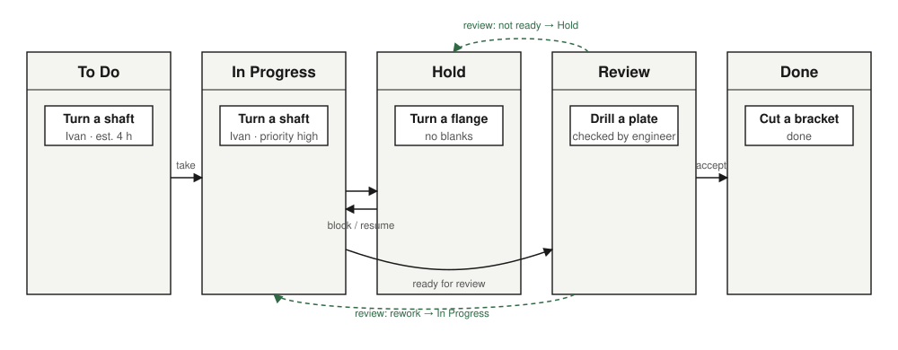

# Заняття 15. Від фізичної канбан-дошки до Trello і Jira: статуси задач, Kanban і Scrum

> **10 листопада 2026 · лекція · 1 год 11 хв.** Матеріал підготовлено за автоматичним транскриптом `IgorSikorskyKPI_L10_101126.mp4`. Це відредагований навчальний конспект, а не дослівна стенограма: очевидні помилки розпізнавання виправлено, терміни уніфіковано з попередніми заняттями. Індивідуальні питання студентів щодо оцінок, імена студентів і третіх осіб не публікуються. Досвід роботи у великих автомобільних компаніях — **особиста практика викладача**, подана без назв компаній. Редакторські уточнення й схеми редакції позначено окремо.

## 0. Організаційне

- Перші хвилини заняття пішли на індивідуальне питання щодо балів у системі «Кампус». Викладач пообіцяв з’ясувати причину зміни через адміністраторів системи й зауважив, що для таких систем бракує прозорої **історії змін** — «як у Git глянути, хто зробив коміт». Подробиці не публікуються.
- Нагадування про безпеку під час повітряної тривоги: «інженерія діє, коли інженер живий».
- Друга атестація — командний проєкт (див. розділ 6). Рекомендований строк — **до кінця листопада**.
- Після другої атестації планується велика **індивідуальна розрахунково-графічна робота (РГР)** приблизно на 60 балів: знову пройти весь шлях — підготовку до конференції, участь у ній, емуляцію зустрічі з клієнтом, презентацію, follow-up, proposal, декомпозицію команди. Вона дасть змогу надолужити пропущені заняття.
- Цей курс покриває **менеджмент** життєвого циклу. Інженерну частину — апаратну й програмну розробку, інтеграцію, валідацію й верифікацію, deployment і закриття проєкту — викладач хотів би дати окремим продовженням, якщо й далі викладатиме в КПІ.

## 1. Звідки взялася канбан-дошка

Логіка Jira, Trello, GitHub Projects чи будь-якої канбан-дошки прийшла з заводу. Керівництву треба було бачити **реальний прогрес кожної задачі**, а не лише «щось робиться».

Приклад викладача: токар Іван має виточити 10 деталей. Для цього йому потрібні креслення й обладнання; потім він робить роботу й передає її інженерові на перевірку. Якщо все гаразд — робота виконана; якщо ні — її повертають на переробку. Може забракнути заготовки — тоді роботу доводиться призупинити.

Так на заводах з’явилася дошка з колонками, а задачі писали на окремих аркушах:

| Статус | Що означає |
| --- | --- |
| **To Do** | Задача відкрита й чекає, поки її візьмуть у роботу |
| **In Progress** | Хтось над нею працює (навіть якщо виконавці змінюються) |
| **Hold** | Роботу зупинено: чогось бракує, задача заблокована |
| **Review** | Роботу зроблено, вона на перевірці |
| **Done** | Перевірку пройдено, задача завершена |

<figure class="diagram lecture-figure"><figcaption class="diagram-note">Рис. 15.1. Канонічна дошка з заняття: п’ять статусів і можливі повернення після рев’ю. Схема редакції за поясненням викладача.</figcaption></figure>

### Як рухається задача

1. Задачу «Виточити вал» вішають у To Do й призначають на Івана. Його питають, скільки часу це займе; Іван каже «4 години» — це **початкова оцінка** (original estimate).
2. На Івана вішають ще й ще задачі, інші — на Максима. Але **одна людина в один момент робить одну роботу**, тому потрібні **пріоритети**: найвищий, середній, низький. Іван бере найвищий і переносить його в In Progress. Якщо задачу з найвищим пріоритетом не взяли, до виконавця будуть питання.
3. Забракло заготовок — задачу кидають у **Hold**.
4. Потрібна немеханічна обробка — Іван **перепризначає** задачу на Колю, той робить свою частину й повертає Іванові. Задача весь час лишається в In Progress, просто над нею працюють різні люди.
5. Готову роботу передають на **Review**. Звідти можуть сказати: «на переробку» (назад в In Progress), «не готові — на hold» або «вже нерелевантна — назад у To Do». Найкращий результат — **Done**.

Суть підходу — дуже простий менеджмент і **трасованість**: видно, куди рухається кожне розпорядження, на кому воно висить і від чого заблоковане.

## 2. Фізична дошка сьогодні: брейншторм і офлайн-планування

Викладач показав фото своїх робочих дошок із не такого далекого минулого — у великих автомобільних компаніях у Скандинавії (назви не наводяться). Там канбан був розписаний стікерами, кольори позначали окремі команди й ризики, задачі «розкидалися» між командами. На сусідніх дошках — брейншторм: схема автомобіля, диференціальні рівняння, сили, моменти, графіки.

Фізичні зустрічі для планування, за словами викладача, знову стали нормою:

- онлайн-інженерія сильно поступається офлайн-інженерії за якістю й швидкістю — «інженерія працює на кухні, коли інженери п’ють каву разом»;
- люди мають побачити одне одного, потиснути руки й «фізично проговорити» наступну ітерацію чи інкремент;
- після спільного планування простіше комунікувати віддалено.

Викладач послався на **Scaled Agile Framework (SAFe)**: раз на квартал команди зустрічаються фізично, планують обсяг робіт, аналізують ризики, розбивають великі задачі на сторі, таски й сабтаски, призначають виконавців і оцінюють — і лише після цього роз’їжджаються по офісах і компаніях в інших країнах.

> **Редакторське уточнення щодо SAFe.** У SAFe цю подію називають **PI Planning** — зазвичай дводенне планування всього Agile Release Train, яке проводять кожні 8–12 тижнів на початку кожного Planning Interval (PI). Фізична присутність бажана, але SAFe допускає й розподілений формат; головне — щоб роботу планували ті, хто її виконуватиме. Отже, ритм прив’язаний до PI, а не до епіка: епік у SAFe — велика ініціатива, що може тривати кілька PI.

Особистий досвід викладача: усі його великі проєкти — і з великими клієнтами зараз — починалися **офлайн, із рукостискання**: знайомство на конференції, оперативне планування, обід у клієнта. Для людей, які навчалися в епоху COVID і війни, офлайн може звучати некомфортно, але для європейського бізнесу це працює ефективніше.

### Чому все ж Jira

Фізична дошка має межі:

- стікери **відклеюються** й губляться, затираються від правок;
- залежності між тасками доводиться показувати буквально **нитками на скотчі**;
- до стікера важко прикріпити артефакт — наприклад, фото корпусу, який треба виготовити;
- після декомпозиції епіків на сторі дошка перетворюється на «суцільно заклеєну шпалеру», навігація стає жахливою.

Тому фізичну дошку використовують для **першого, високорівневого етапу**, а повсякденну рутину й поточний статус ведуть у Jira, Trello чи GitHub Projects. Так поєднуються переваги обох світів.

Для тих, хто бачить себе в менеджменті, викладач рекомендував два безкоштовні джерела: сайт **SAFe** (пройтися його інтерактивною картою «дуже в деталях») і **Project Management Institute (PMI)** — міжнародну організацію, що канонізує процеси управління проєктами. Детальний розбір Kanban, Scrum і SAFe — предмет окремих курсів. «Я хотів би, щоб через якийсь час кожен з вас давав роботу, а не робив роботу».

## 3. Trello: мінімальна дошка за кілька хвилин

**Trello** належить Atlassian — тому ж вендору, що й Jira. Це інструмент для невеликих проєктів, яким потрібне просте й безкоштовне відстеження задач.

> **Редакторське уточнення.** Atlassian оголосила про купівлю Trello 9 січня 2017 року й завершила угоду 3 лютого 2017 року.

На занятті викладач створив акаунт і нову дошку зі списками **To Do, In Progress, Hold, Review, Done** — «дуже проста, канонічна борда» — і першу картку «Збір інформації про робот» (продовження прикладу з заняття 14). Що можна зробити з карткою:

| Елемент картки | Навіщо |
| --- | --- |
| Members (виконавець) | Хто відповідає за задачу |
| Labels (мітки) | Швидка візуальна категорія, наприклад *Documentation* |
| Dates | Початок і кінець — таймлайн, як у плані епіку з заняття 14 |
| Checklist | Проміжні кроки, напр. «Пошукати існуючі роботи-маніпулятори»; пункт можна призначити іншій людині з власним строком або винести в окрему задачу |
| Comments | Обговорення з тегуванням колег (@згадка) — те, чого майже неможливо досягти на фізичній дошці |

Пріоритетів у картці викладач не знайшов і запропонував лайфхак: **задачі вищого пріоритету переміщувати вгору** списку.

> **Редакторське уточнення.** У Trello справді немає вбудованого поля пріоритету. Його задають мітками, порядком карток у списку або custom field (доступно в платних планах чи через Power-Ups).

Рух картки — drag & drop: взяв у роботу → In Progress, закінчив → Review з коментарем «переглянь, будь ласка», рецензент переносить у Done або повертає в In Progress із зауваженнями. Сповіщення приходять на пошту й у мобільний застосунок.

**Сильні сторони Trello:** розгортання за хвилини, усі мінімально необхідні інструменти, мобільний застосунок.

**Слабкі сторони:** немає правил переходів — будь-яку картку можна просто перетягнути в Done; історію змін відстежувати важко. Викладач назвав Trello «видом дитячого садка» серед таких інструментів.

### Практика викладача: Trello для неінженерних ролей

Викладач використовує Trello для **окремих неінженерних доменів**. Наприклад, у нього є бухгалтер, і для нього створено окрему дошку із задачами на кшталт «оплатити закупівлю гвинтів» чи «забезпечити доставку в Україну й розмитнення корпусів». З інженерами він працює в Jira. Ці світи він **ізолює**: фінансовий відділ не має доступу до інженерного, бо інакше «починається безлад».

Студент заперечив, що в Jira для цього є окремі простори (spaces). Відповідь викладача: Trello **простий**, а це важливо, коли маєш справу не з інженерами. Викладач активно працює з фрілансерами — інженерами, юристами, фінансистами. Людина, якій некомфортно в Jira, витрачає там багато оплачуваного часу. Мета — прозорий процес для замовника робіт і мінімум часу й коштів на виконавця.

## 4. Jira: коли команд і підрозділів багато

Trello зручний на базовому рівні, але недостатньо гнучкий для великих проєктів, де багато команд і навіть підрозділів. **Jira** — «доросла версія». Її переваги:

- підтримка **розгалужених команд** і багатьох підрозділів;
- **зв’язок із Git** (GitHub, GitLab): згадуєте коміт у Jira — переходите в Git; згадуєте тікет Jira в коміті — переходите в Jira;
- автоматизація й фільтри;
- **workflow** — правила, за якими задача може змінювати статус. У Trello таких правил немає, «і це кошмар — воно так не повинно бути».

На занятті викладач створив робочий простір Jira для демо-проєкту. Уже під час створення Jira пропонує обрати підхід: **Kanban, Scrum** або шаблон для бізнес-команд. Тому спершу треба зрозуміти різницю між ними. Налаштування Jira перенесено на наступне заняття.

> **Редакторське уточнення.** З вересня 2025 року в Jira Cloud «проєкти» (projects) перейменовано на «простори» (spaces). Змінилася лише назва; робочі процеси, фільтри й інтеграції працюють як раніше.

## 5. Kanban чи Scrum: приклад із мишкою

Більшість студентів працювали зі Scrum, із Kanban — ні. Викладач пояснив різницю на побутовому прикладі.

**Kanban — техпідтримка.** Інженерові потрібна нова мишка. Тікет потрапляє в IT-департамент:

1. IT-фахівець бере тікет у роботу й перепризначає на завідувача складу: «перевір, чи є мишка».
2. Мишку передають зі складу в IT, IT перепризначає задачу на офіс-адміністратора: «віднеси на пошту, відправ».
3. Задача висить на офіс-адміністраторі, доки отримувач не отримає мишку.
4. Інженер підтверджує отримання, офіс-адміністратор повертає задачу в IT, IT вносить заміну в реєстр обладнання (щоб уникнути зловживань).
5. Інженер переносить задачу на review й підтверджує, що мишка працює; IT закриває задачу — Done.

Одна ітерація, без спроб: «взяли й вирішили».

**Той самий IT-департамент за Scrum (для приколу).** Ітерація 1: «спершу надішлю тобі батарейку — може, мишка запрацює». Не запрацювало — батарейка повертається. Ітерація 2: «може, не працює радіомодуль — надішлемо радіомодуль». І так далі: через багато місяців або мишку зберуть заново, або все ж надішлють нову. Для техпідтримки **Kanban значно реалістичніший**.

**Розробка виробу — інша справа.** Будь-який hardware-інженер скаже, що електроніку за одну ітерацію не зробиш:

| Ітерація | Що відбувається |
| --- | --- |
| 1 | Схема, трасування плати, закупівля компонентів, виробництво. Не запрацювало; ріжуть доріжки, перепаюють, і плата «шкутильгаючи» починає щось робити |
| 2 | Виправлення схематики й трасування з урахуванням досвіду — працює плюс-мінус |
| 3 | Компоненти задорогі — програємо конкуренцію; шукають доступні аналоги без зміни схеми |
| 4 | «Прострілює» на корпус — додають захист від розряду (діоди, мости). Нарешті все гаразд |

Software дуже подібний: перша ітерація «на милицях», далі оптимізація, а потім інтеграційні й end-to-end тести, кожен із яких приносить нові сюрпризи й виправлення. Висновок викладача: **ітеративний підхід (Scrum) властивий інженерії комп’ютерних систем — hardware, software й системній інженерії**; Kanban — задачам на кшталт техпідтримки.

> **Редакторське уточнення.** У канонічних визначеннях різниця формулюється інакше. **Kanban Guide** (Vacanti, Coleman) описує Kanban як стратегію оптимізації потоку цінності: визначення робочого процесу (Definition of Workflow), явний контроль незавершеної роботи (WIP limits) і метрики потоку. Ітерації він не вимагає й не забороняє, а Kanban-практики широко застосовують і в командах розробки. **Scrum Guide** описує спринти тривалістю до місяця, події й артефакти. Приклад викладача — практична евристика вибору: потік однотипних незалежних запитів добре лягає на Kanban, а розробка з високою невизначеністю — на ітерації.

## 6. Завдання до другої атестації

Кожна з чотирьох команд готує **один проєкт** обраного виробу:

| Що здати | Зміст |
| --- | --- |
| Опис архітектури | Architecture description обраного виробу |
| Proposal | Summary, architecture description, design description |
| План | Діаграма досяжності проєкту — діаграма Ганта |
| Ресурси й кошти | Діаграма залученості інженерів, вартість |
| Моделі роботи | Для кожного етапу — обґрунтований вибір: Fixed Price, Time & Material чи комбінація (чому саме так для R&D, MVP тощо) |
| Простір у трекері | Jira (рекомендовано), Trello або GitHub Projects |
| Структура робіт | Епіки, сторі, таски, сабтаски |
| Backlog за Scrum | Щонайменше **4 двотижневі спринти** |
| Команда | Учасники команди додані в простір; попереднє призначення тікетів і попередня оцінка кожної задачі |

Частину про Jira / Trello / GitHub Projects курс ще не покрив — з неї почалося це заняття, а продовжилося наступне.

## Практичні висновки

- Канбан-дошка — цифрова копія заводської: To Do, In Progress, Hold, Review, Done.
- Одна людина в один момент робить одну задачу, тому пріоритети обов’язкові.
- Перепризначення не змінює статусу: задача лишається в роботі, поки її хтось робить.
- Фізична дошка лишається найкращою для першого спільного планування; щоденний статус ведуть у трекері.
- Trello — швидкий і простий, але без правил переходів; зручний для неінженерних ролей.
- Jira — для багатьох команд, інтеграції з Git, автоматизації й контрольованого workflow.
- Kanban добре працює для потоку незалежних запитів; розробка виробів з невизначеністю — ітеративна.

## Питання для самоперевірки

- Які п’ять статусів має канонічна дошка і що означає кожен?
- Чому без пріоритетів дошка не працює, якщо виконавців мало?
- Чим перепризначення задачі відрізняється від зміни її статусу?
- Навіщо планувати офлайн, якщо є Jira?
- Що таке PI Planning у SAFe і як часто його проводять?
- Які обмеження фізичної дошки компенсує цифровий трекер?
- Чому відсутність правил переходів у Trello небезпечна?
- Як задати пріоритет картки в Trello, якщо такого поля немає?
- Чому заміну мишки логічно вести за Kanban, а розробку плати — ітераціями?
- Що має містити командний проєкт до другої атестації?

## Що далі

Викладач оголосив, що налаштування Jira продовжиться наступного дня. Це продовження опубліковано як **заняття 16**.

## Перевірені посилання

- SAFe, PI Planning: https://framework.scaledagile.com/pi-planning/
- Project Management Institute: https://www.pmi.org/
- Atlassian — оголошення про купівлю Trello (SEC, 2017): https://www.sec.gov/Archives/edgar/data/0001650372/000165037217000002/a992atlassianpressrelease1.htm
- Atlassian Community — Jira «projects» стають «spaces»: https://community.atlassian.com/forums/Jira-articles/Evolving-Jira-terminology-Projects-will-soon-be-Spaces/ba-p/3034977
- Trello — пріоритет через custom field або Power-Up (Atlassian Community): https://community.atlassian.com/t5/Trello-questions/Trello-Card-Priority/qaq-p/1790778
- The Kanban Guide: https://kanbanguides.org/english/
- The Scrum Guide (2020): https://scrumguides.org/scrum-guide.html
