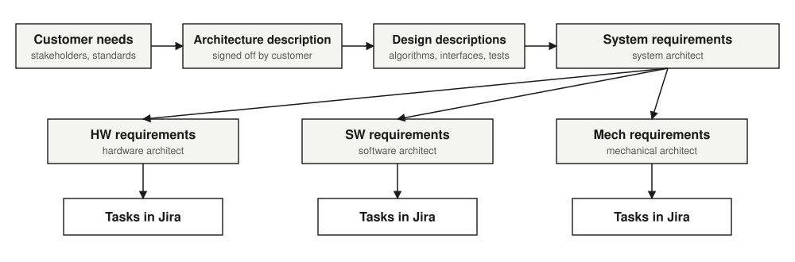
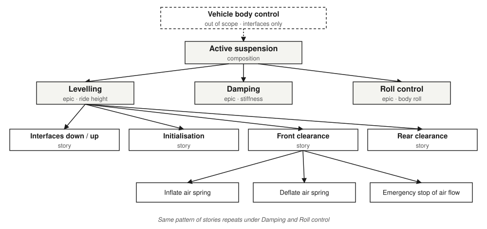
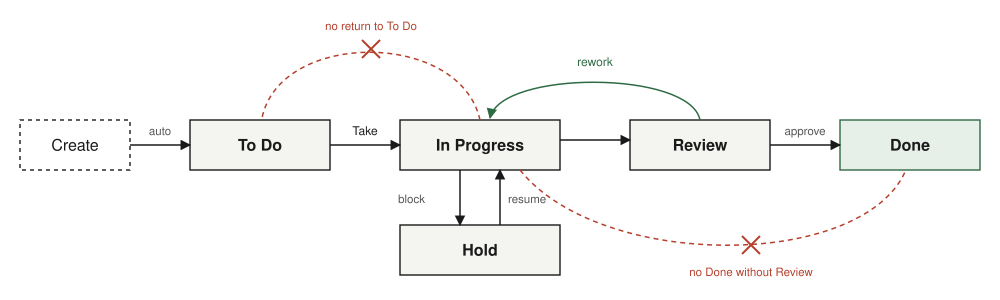

# Заняття 16. Jira на практиці: ієрархія робіт, workflow, story points і ємність спринту

> **11 листопада 2026 · практичне заняття · 1 год 36 хв.** Матеріал підготовлено за автоматичним транскриптом `IgorSikorskyKPI_L11_111126.mp4`. Це відредагований навчальний конспект, а не дослівна стенограма: очевидні помилки розпізнавання виправлено, терміни уніфіковано з попередніми заняттями. Імена студентів і третіх осіб не публікуються. Розмова про практику й співбесіди — **думка й досвід викладача**. Редакторські уточнення й схеми редакції позначено окремо.

## 0. Організаційне

- Під час заняття було дві тривоги; під час ракетної загрози викладач оголосив 10-хвилинну перерву й попросив усіх, хто в Києві, перейти в укриття: «Воно того не варто».
- Заняття продовжує заняття 15: учора створили дошку в Trello, сьогодні — налаштування Jira.

## 1. Повторення: що має бути в тікеті

Нагадування на прикладі Trello (вендор той самий, що й у Jira та Confluence — Atlassian, «фактично монополіст у трасованості процесів і задач»):

| Поле | Правило |
| --- | --- |
| Стадія | To Do, In Progress, Hold, Review, Done — або інші, залежно від вашого робочого процесу |
| Назва | Лаконічна, але достатня, щоб зрозуміти задачу |
| **Description** | Що зробити, які очікуються результати й **критерій завершення** (definition of done); важливі уточнення автора — «дані на сайті», «таблиця в Excel» |
| Коментарі | Лишаються в історії з датою й часом; редагування коментарів можна заборонити |
| Assignment | На кого призначено задачу |
| Labels | Категорія (testing, documentation…) — аналог міток у GitHub, щоб швидко знайти групу тікетів |
| Дати | Старт обов’язковий, фініш бажаний — до коли задача актуальна |
| Сабтаски / чек-лист | Виконавець закриває пункти один за одним — прогрес видно |

Якщо задачу не прописано детально, виконавець або зробить «щось не те», або витрачатиме ваш час на пояснення, або скаже: «Ви недостатньо пояснили задачу, тому я зробив так».

**Правило викладача:** після **кожної зміни статусу** (In Progress → Hold, In Progress → Review, Review → Done) лишайте коментар — що перевірили, чи є зауваження. Це запобіжник: людина справді попрацювала з задачею, а не перетягнула її машинально.

**Чому Trello небезпечний:** картку з In Progress можна перетягнути одразу в Done, оминувши Review. Якщо перехід у Done автоматично запускає GitHub Action, що робить merge у main, неперевірений код потрапляє в головну гілку — серйозне джерело помилок.

## 2. Kanban і Scrum: що потрібно знати до старту

Scrum — не апогей, а **одна з моделей** роботи команди. Його мінус — **надмірність**: розробку «прокатують» кілька разів ітеративно, постійно покращуючи. Викладач сформулював це так: спочатку — щоб працювало, потім — щоб працювало добре, потім — щоб виглядало красиво. Чотири ітерації займають більше часу: продукт ви отримаєте пізніше, але з меншими ризиками.

> **Редакторське уточнення.** Цю послідовність зазвичай цитують як «Make it work, make it right, make it fast» і приписують Кенту Беку; схожу думку раніше формулював Браян Керніган.

Чому не завжди Kanban, який, за словами викладача, «з першої ітерації видає і гарно, і якісно»? Бо Kanban у його розумінні передбачає одну умову: **ще до початку проєкту дуже чітко розуміти, що ви робите**. Немає місця research, спробам і помилкам. Потрібні:

1. **Requirements engineering** — величезна галузь: стандарти, гайдлайни, фреймворки, дуже чітка комунікація зі стейкхолдерами й замовником. До проєкту залучають людей, які знають процеси й стандарти: архітекторів, technical writers, лідів.
2. **Architecture description** — великий документ строгого контролю, який описує всю систему «на папері, у форматі А4». Його узгоджують із замовником; той підтверджує листом або підписом, що документ повністю відповідає тому, що він хоче отримати.
3. **Design descriptions** — декомпозиція архітектури: кожен шматок системи з алгоритмом роботи, інтерфейсами, технологіями й підходом до тестування.
4. **Розподіл між архітекторами.** Системний архітектор передає галузевим архітекторам (software, hardware, mechanics) великі шматки роботи разом із system requirements. Hardware-архітектор «пропускає їх через себе» й видає **hardware requirements**, а з них нарізає таски в Jira. Таски покривають його вимоги, його вимоги — системні.

<figure class="diagram lecture-figure"><figcaption class="diagram-note">Рис. 16.1. Підхід «усе описано до старту» за поясненням викладача: від потреб замовника до тасок у Jira. Схема редакції.</figcaption></figure>

Тоді все прописано до початку роботи, і система буде найкраще узгоджена. Приклад із **практики викладача**: він був архітектором апаратного модуля зі своїми інтерфейсами, а інший архітектор на боці клієнта описував джгути. Через брак комунікації джгут і інтерфейс не зійшлися — різниця в кілька міліметрів. Довелося терміново робити адаптер-перехідник, а виправити це вдалося лише в наступній ітерації розробки через пів року. «Ми не наслідували Kanban: робили за Scrum — і він, і я окремо, паралельно — і отримали два неузгоджені шматки однієї системи».

**Scrum** — для роботи, де «фіг його знає, як це робити»: є загальне розуміння, але невідомо, що всередині, які методи й бібліотеки. Починають з інтерфейсів, потім шукають основну бібліотеку, стикують її з інтерфейсами, потім UI. «Є неосяжне поле, яке треба виорати: взяли один квадратик — виорали, стало зрозуміліше, — пішли далі».

Якщо ж усе можна описати одразу — тоді Kanban дає чудову систему «за один заскок». Але якщо «флопнули» на рівні системної інженерії — шансів виправити не буде: «гігантські інвестиції, кинуті під поїзд».

> **Редакторське уточнення.** Те, що викладач тут називає Kanban, — це **план-орієнтований підхід** (waterfall, V-модель): повна специфікація й архітектура до старту, формальне погодження із замовником. Саме такий підхід типовий для проєктів за ISO 26262 чи Automotive SPICE. Канбан-дошку часто використовують для **виконання** такого плану. У канонічному визначенні (Kanban Guide) Kanban — це стратегія оптимізації потоку з контролем незавершеної роботи; повної специфікації до старту вона не вимагає. Головна думка заняття від цього не змінюється: чим краще описано систему до старту, тим менше ітерацій потрібно; чим більше невизначеності — тим більше ітерацій.

## 3. Приклад: активна підвіска автомобіля — від композиції до тасок

Наскрізний приклад заняття — **активна підвіска автомобіля**, лише програмна частина (hardware й механіка — out of scope).

| Рівень | Що це в прикладі |
| --- | --- |
| Композиція | Активна підвіска |
| Епіки (компоненти) | **Levelling** — зміна кліренсу; **Damping** — зміна жорсткості; **Roll control** — контроль крену, щоб авто не заносило |
| Сторі | Інтерфейси; первинна ініціалізація; реалізація зміни кліренсу передньої й задньої частини |
| Таски | Нагнітання повітря в пневмоподушку; спускання повітря; аварійна зупинка потоку повітря |

Над композицією є ще вищий рівень — керування положенням кузова, ще вище — система керування автомобілем. Але це **out of scope** команди: з тими командами ходять на дзвінки й узгоджують **інтерфейси**, але нічого для них не імплементують. Тому окремо прописують **інтерфейси вниз** (до виконавчих механізмів) і **інтерфейси вгору** (до вищої програмної частини керування автомобілем).

<figure class="diagram lecture-figure"><figcaption class="diagram-note">Рис. 16.2. Декомпозиція активної підвіски з заняття: композиція → епіки → сторі → таски. Схема редакції.</figcaption></figure>

## 4. Налаштування простору Jira

Викладач створив простір за **Scrum** — «ітеративний підхід для software engineering — прямо клева штука» — з назвою *Vehicle body control active suspension*. На дошці з’явилися **спринт** (часовий інтервал для розв’язання задач) і **backlog** («кошик», де задачі чекають, поки їх візьмуть у спринт).

За замовчуванням можна було створювати лише сторі, фічі й баги, тому в налаштуваннях простору додали **Epic** і сконфігурували поля кожного типу роботи:

| Тип | Поля, які лишили | Що прибрали і чому |
| --- | --- | --- |
| **Epic** | Summary, Description (обов’язковий), Assignee (необов’язковий — епік може належати команді загалом), Start/Due date, Reporter — хто створив і відповідає | Sprint — епік абстрактніший за спринт; Story points — стосуються фіч, тасок і сабтасок; Parent — епік над епіком виходить за канонічну ієрархію |
| **Bug** | Original estimate (за скільки виправимо), Assignee, Parent (задача, у якій знайшли баг), Due date, Labels, Team, Start date, **Sprint** (у який спринт виправляємо), **Priority** | — |
| **Feature / Task** | Summary, Description з критерієм завершення, Original estimate, Priority, Assignee, Parent (епік), Due date, Labels, Team, Start date, **Story points**, **Time tracking** | — |

**Team** потрібен, бо команд може бути кілька: одна — levelling, друга — damping, третя — roll control, плюс тестувальники, DevOps тощо. Задачу можна призначити на всю команду, і команда сама вирішить, хто її робить.

**Time tracking** важливий за моделі **Time & Material**: клієнт хоче знати, на що саме пішов час («на таку-то фічу — 20 годин»), а не просто раз на місяць отримувати великий інвойс. У Jira можна запустити й зупинити таймер або внести час вручну.

### Workflow

Головне налаштування — **workflow**, тобто якими шляхами задача може рухатися статусами:

| Перехід | Правило |
| --- | --- |
| Створено → **To Do** | Автоматично, без умов |
| To Do → **In Progress** | Тільки через дію «Take» |
| In Progress ↔ **Hold** | Можна зупинитися, якщо заблоковані; з Hold — лише назад в In Progress |
| In Progress → **Review** | Робота готова до перевірки |
| Review → **Done** | Тільки після рев’ю |
| Review → **In Progress** | Рецензент знайшов проблему — на доопрацювання |
| Будь-що → To Do | **Заборонено**: задача ніколи не повертається в To Do |
| Будь-що → Done | **Заборонено**, крім як із Review |

<figure class="diagram lecture-figure"><figcaption class="diagram-note">Рис. 16.3. Workflow, налаштований на занятті: Done — тільки через Review, повернення в To Do немає. Схема редакції.</figcaption></figure>

Такий workflow «безпечний: ніхто не зможе обійти систему». Його застосували до всіх типів робіт. Для **багів** хотілося прибрати Hold, але викладач залишив його: без Hold можливий **вічний цикл** In Progress → Review → In Progress. Якщо ідеї, як виправити баг, закінчилися, баг має десь «спочити», а не забирати час на «биття лобом у стіну».

## 5. Story points

Чи можна одразу сказати, скільки коштуватиме й займе фіча levelling — щоб авто на ходу піднімалося перед з’їздом у ліс і опускалося на трасі? «Рік, може два, з десятьма інженерами, а може, двадцятьма» — це вгадайка. Цілу фічу ніхто при здоровому глузді не оцінює; її **розбивають на маленькі шматки**.

1. **Інтерфейс** між системою керування й компресором: запит на новий тиск — фактично один параметр. Компресор сам знає свій поточний тиск і вирішує, накачати чи спустити. Це вже можна оцінити: один інженер певного рівня — приблизно два дні.
2. **Оцінка поточного тиску** — «це вже важче». Ключове слово — *важче*: йдеться про **відносні величини**.

Найпростіша задача, яку вдалося прив’язати до часу й конкретної людини, — це **1 story point**. Менших задач, найімовірніше, вже не буде. Решту оцінюють відносно неї:

| Задача фічі levelling | Оцінка |
| --- | --- |
| Інтерфейс до компресора | 1 SP |
| Виміряти поточний тиск | 3 SP (≈ утричі складніше) |
| Керувати тиском — регулятор (P, PI, PID, LQR…) | 6 SP |
| **Фіча levelling загалом (спрощено)** | **≈ 10 SP** |

Немає математичної формули на кшталт «сторіпоінт — це 10 людино-годин інженера такого-то класу»: люди різні, і «класів» немає.

### Як команда голосує

Оцінку робить уся команда, і **голоси рівні** — викладача, тімліда чи джуна. На занятті кожен назвав свою оцінку задачі «вимір рівня»: від 4 до 9 SP. Середнє — **6,25**, яке **завжди округлюють угору**, до 7: через ризики.

Найцінніше — **крайні значення**:

| Крайність | Можливі причини |
| --- | --- |
| Максимум (9) | Інженер хоче більше часу, «щоб погуляти» (за словами викладача, найпоширеніше); досвідчений інженер уже робив подібне й знає, де вилазять проблеми; просто був неуважний |
| Мінімум (4) | Інженер робив щось подібне й знає, як зробити швидше |

Обидві крайності — «дар богів»: або ви на ранній стадії виявляєте проблему, або знаходите людину з досвідом і швидший спосіб розв’язання. «В адекватному бізнесі немає місця наїздам на команду».

> **Редакторське уточнення.** Описана вправа близька до **Planning Poker** (James Grenning, 2002; популяризував Mike Cohn у 2005 році). Канонічно всі показують оцінку одночасно, щоб уникнути «якоря», потім автори найвищої й найнижчої оцінки пояснюють свої міркування, і команда голосує знову, доки оцінки не зійдуться. Часто використовують шкалу, схожу на ряд Фібоначчі (1, 2, 3, 5, 8, 13…). Усереднення з округленням угору — поширений варіант. Прив’язка «1 SP = 2 дні» — це локальна домовленість команди для першого спринту; далі ємність зазвичай прогнозують за фактичною швидкістю (velocity) попередніх спринтів.

## 6. Пріоритети й ємність спринту

**Пріоритети визначаються залежностями.** Від інтерфейсів залежить усе, тож їхній пріоритет — найвищий. Без вимірювання поточного рівня неможливо керувати — високий. Запит рівня — високий. Керування й зміна рівня стають можливими лише після цього.

**Розрахунок ємності:**

| Параметр | Значення |
| --- | --- |
| 1 story point | 2 робочі дні одного інженера (оцінка команди) |
| Спринт | 2 тижні = 10 робочих днів (завжди починають із двох тижнів, потім можна змінити) |
| Інженерів у команді | 3 |
| Внесок одного інженера | 0,5 SP на день × 10 днів = 5 SP |
| **Ємність спринту** | **3 × 5 = 15 SP** |

Задачі перетягують у спринт за пріоритетом: 1 + 7 + 4 = 12 SP. Наступна задача дає вже 16 SP — більше за ємність, тому створюють **спринт 2** і продовжують заповнювати його.

«Хитрий» варіант — розрізати задачу на дві частини, щоб дотягти перший спринт до 15, — викладач відкинув. Задача може взагалі не різатися інженерно; до того ж за спринт з’являться нові задачі, а зміна спринту — «смертний гріх».

**Чому не можна перевантажувати спринт, особливо перший:**

- перший спринт **ніколи не проходить гладко**: комусь не встановили інструменти, до когось не приїхав комп’ютер, двоє інженерів сперечаються за місце біля вікна, на когось дме кондиціонер;
- на «математику спринту» накладається команда: хтось когось не злюбив, хтось п’є чай, а не каву — і робота йде повільніше;
- **фактор автобуса**: будь-хто може захворіти чи вибути, і його задачі лягають на менше людей.

Тому план на 15 SP — **ідеалістичний**. Викладач послався на SAFe і PMI: завантажуйте спринт **до 80 % ємності**. Він лишив перший спринт на 12 SP.

> **Редакторське уточнення.** У Scrum Guide (2020) сказано, що під час спринту не вносять змін, які загрожують меті спринту (Sprint Goal); водночас обсяг можна уточнювати й переглядати з Product Owner. Отже, «смертний гріх» — це зміни, що підривають мету спринту, а не будь-яке уточнення. Щодо 80 %: SAFe прямо радить не планувати на 100 % ємності, а його нормована оцінка (8 SP на повну ставку за двотижневу ітерацію) відповідає приблизно 80 % робочого часу. Окремої норми «80 %» у публікаціях PMI ми не знайшли; це поширене емпіричне правило.

Після кожного спринту — **ретроспектива** й планування наступного: менеджер дивиться, як минув спринт, призначає задачі в новий і потроху налаштовує процес. Мета — щоб команді було комфортно працювати скільки завгодно, клієнт міг платити скільки завгодно, а продукт розвивався скільки можливо. «Якщо я досягну цього — я хороший менеджер». Найсильніший інструмент тут — **фідбек команди** в кінці спринту.

## 7. Поза темою: практика й джуни (думка викладача)

Під час перерви на укриття зайшла розмова про переддипломну практику, якої в групі, за словами студентів, не передбачено. Викладач вважає практику на підприємстві дуже цінною:

- диплом на основі реального обладнання, задач і корпоративних процесів — це зовсім інше, ніж абстрактна тема;
- студенти приносять на кафедру сучасні підходи — «корисний стрес» для кафедри, яка інакше «вариться у власному соку»;
- рік тому викладач узяв студентів-практикантів у свій проєкт, і вони показали себе настільки добре, що компанія взяла їх на роботу.

Студент розповів, що потрапити на співбесіду на джуна значно важче, ніж на мідла. Пояснення викладача: це **проблема менеджменту**. Нетехнічний менеджер боїться джунів — «це ж треба їм усе пояснювати». Технічно підкований — бачить переваги: креативність без «стінок» і можливість зробити проєкт дешевше з більшою маржинальністю. Колосальна різниця в зарплатах, за оцінкою викладача, означає, що місяць роботи сеньйора — це майже рік роботи трейні. Порада: на співбесіді знайдіть слова, щоб донести цей аргумент до менеджменту.

## Практичні висновки

- Добрий тікет: лаконічна назва, опис із критерієм завершення, виконавець, мітки, дати, сабтаски.
- Коментар після кожної зміни статусу — запобіжник від машинального перетягування.
- Перехід у Done в обхід Review небезпечний, особливо з автоматичним merge.
- Чим повніше система описана до старту, тим менше потрібно ітерацій; за високої невизначеності — Scrum.
- Ієрархія робіт: композиція → епіки → сторі → таски; інтерфейси вгору й униз — окремі роботи.
- Workflow: Done — тільки через Review, в To Do не повертаються, Hold — захист від вічних циклів.
- Story points — відносна оцінка від найпростішої задачі; голосує вся команда, крайні оцінки обговорюють.
- Ємність спринту рахують від команди й тривалості спринту; перший спринт не завантажують повністю.

## Питання для самоперевірки

- Що має містити description тікета і що таке definition of done?
- Чому після кожної зміни статусу варто лишати коментар?
- Чим небезпечний перехід In Progress → Done разом з автоматичним merge?
- Що потрібно мати до старту, щоб працювати без ітерацій, і в чому ризик такого підходу?
- Як співвідносяться system requirements і hardware requirements?
- Як декомпозувати активну підвіску на епіки, сторі й таски?
- Які поля потрібні епіку, а які — багу, і чому?
- Чому в workflow для багів залишили Hold?
- Що таке 1 story point і як оцінюють решту задач?
- Чому середню оцінку округлюють угору і навіщо обговорювати крайні значення?
- Як порахувати ємність спринту для 3 інженерів, спринту в 2 тижні й 1 SP = 2 дні?
- Чому перший спринт не варто завантажувати на 100 %?

## Що заплановано далі (прогноз)

Конкретної теми наступного заняття викладач не оголосив. **Прогноз редакції**, а не анонс: з огляду на вимоги до другої атестації ймовірні діаграма Ганта й діаграма залученості інженерів, розрахунок вартості, наповнення backlog щонайменше на чотири двотижневі спринти, призначення й оцінка задач, а також GitHub Projects — третій інструмент, згаданий на занятті 15.

## Перевірені посилання

- The Scrum Guide (2020): https://scrumguides.org/scrum-guide.html
- The Kanban Guide: https://kanbanguides.org/english/
- SAFe — «Planning to 100% capacity? Don’t do it!»: https://scaledagile.com/planning-to-100-capacity-dont-do-it/
- SAFe, Iteration Planning: https://framework.scaledagile.com/iteration-planning/
- Make it work, make it right, make it fast (Kent Beck): https://dev.to/weeklydevtips/make-it-work-make-it-right-make-it-fast
