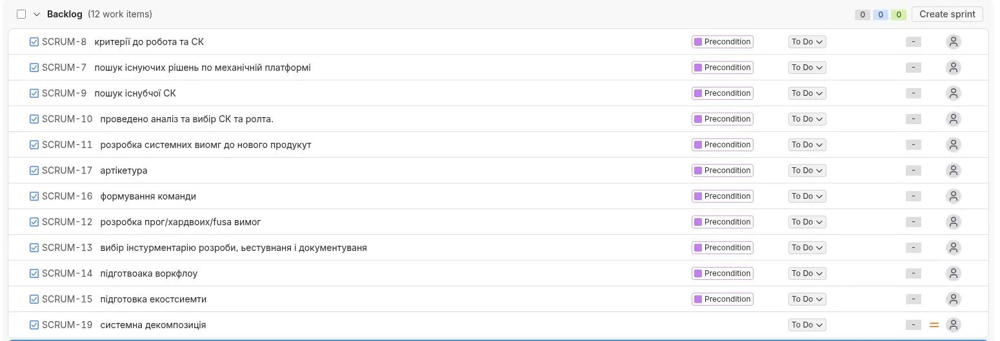
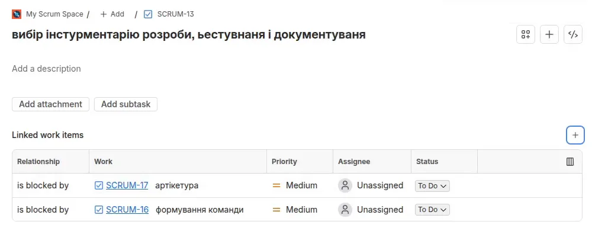
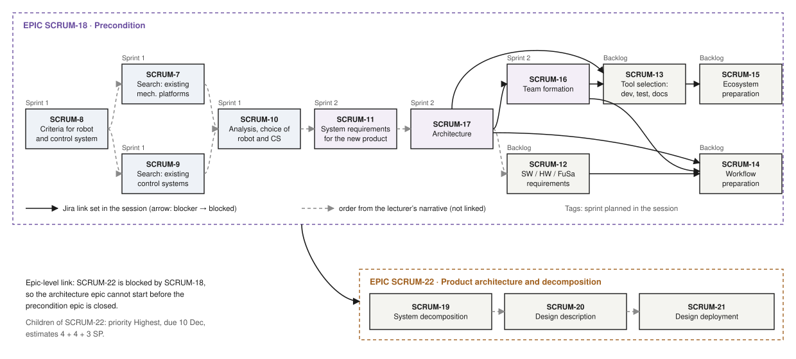
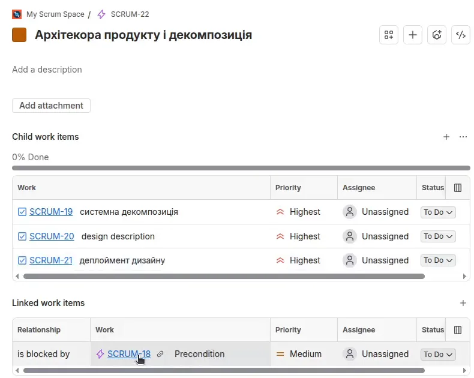
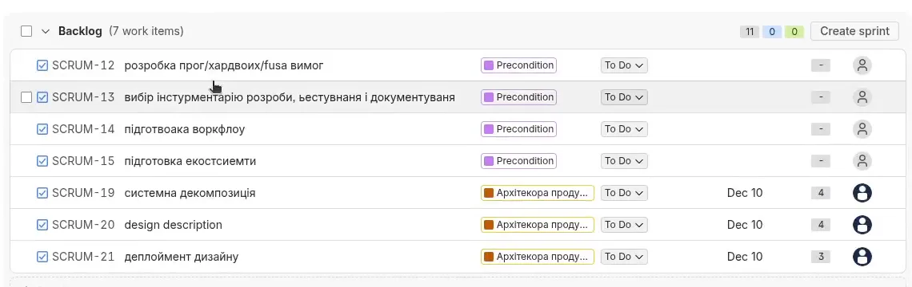
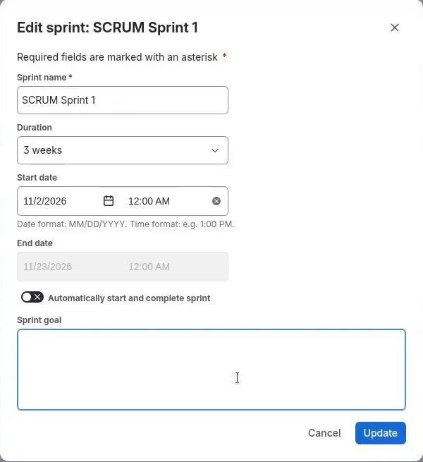
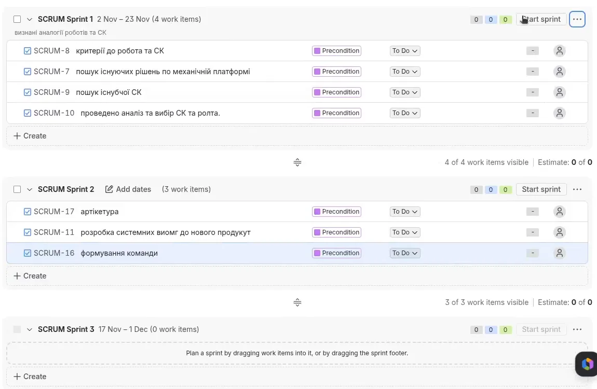
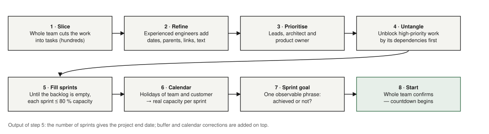
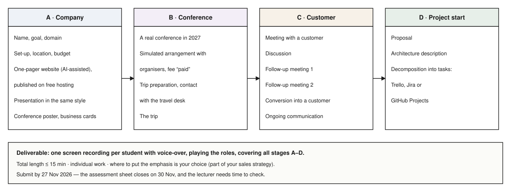

# Заняття 17. Старт проєкту в Jira: precondition, залежності, епіки, ціль і ємність спринту

> **17 листопада 2026 · практичне заняття · 1 год.** Матеріал підготовлено за автоматичним транскриптом і **відеозаписом** заняття `IgorSikorskyKPI_L12_17112006.mp4`: назви тікетів, зв’язки між ними, налаштування спринтів і епіків, які викладач показував на екрані, додано з відео. Це відредагований навчальний конспект, а не дослівна стенограма: очевидні помилки розпізнавання виправлено, терміни уніфіковано з попередніми заняттями. Імена студентів не публікуються; календар викладача, який він показував як приклад, не відтворюється. Досвід роботи в компаніях — **особиста практика викладача**. Редакторські уточнення й схеми редакції позначено окремо. **Завдання до другої атестації — у розділі 8.**

## 0. Організаційне

- На початку заняття в Києві тривала повітряна тривога (жовтий рівень). Викладач попросив підтвердити, що всі в безпеці, нагадав, що заняття записується, і що за реального ризику краще переглянути запис пізніше: «Хороший інженер — це живий інженер».
- Заняття продовжує 15-те й 16-те: тоді описали шлях задачі від старту до завершення (workflow), пройшли типи тікетів, обрали для курсу Scrum-дошку, створили два спринти й домовилися, за якими критеріями розкидати задачі.
- Наприкінці викладач оголосив **завдання до другої атестації** (розділ 8) і тему наступного заняття (розділ 9).

## 1. Де брати найкращі практики: PMBOK і SAFe

Моделі ведення проєктів відрізняються від компанії до компанії й від проєкту до проєкту, але є визнані найкращі практики.

**PMBOK** (Project Management Body of Knowledge) — збірка найкращих практик для різних видів менеджменту в проєктах. Старі версії можна купити або завантажити безкоштовно. В Україні є спільнота, яка проводить тренінги й сертифікацію; сертифікат — добрий сигнал, що кандидата варто розглянути як потенційного менеджера проєкту. На екрані викладач показав сторінку українського перекладу «Настанови PMBOK» (сьоме видання) на сайті PMI Ukraine.

**SAFe** (Scaled Agile Framework) — масштабування Agile для випадку, коли **команд багато**, між ними є спільні залежності, і вони мають працювати ізольовано одна від одної, але так, щоб продукт зрештою вийшов. За словами викладача, SAFe використовують, зокрема, великі автовиробники, коли розробляють новий автомобіль: якщо таких команд, як ваша, багато і кожна робить свій шматок виробу, найімовірніше, керівництво обере SAFe як інструмент релізів.

Якщо ж продукт невеликий і його роблять одна–чотири команди, у SAFe ніхто інвестувати не буде: оберуть Agile (Scrum), Waterfall, Kanban чи іншу просту модель із PMBOK.

| Підхід | Коли доречний | Ціна |
| --- | --- | --- |
| **SAFe** | Багато команд, спільні залежності, великий виріб (наприклад, автомобіль) | Багато рутин: комунікація між інженерами, планування, аналіз ризиків, backlog refinement, демо, планінги, зустрічі, голосування |
| **Scrum / Agile** | Один продукт, одна або кілька команд | Рутин помітно менше, ніж у SAFe |
| **Waterfall, Kanban** | Добре зрозумілі задачі, малий масштаб | Найменше рутин |

**Що ви купуєте цією ціною.** Ви платите тим, що кожен інженер інвестує частину свого часу в кооперацію. Натомість SAFe на системному рівні розв’язує інтеграцію, тестування, контроль якості, сертифікацію, заміну інженера, який рано чи пізно захоче звільнитися. Для проєкту це не «шокуючий контент», а звичайна рутина. Загальніші підходи «пережовують» такі ситуації значно важче.

**Коли SAFe не потрібен.** Виріб робить одна різнопрофільна команда (hardware, механіка, firmware, desktop, дизайнери), і він вміщається в один-два інкременти — орієнтовно до пів року, максимум до року. Тоді інвестувати час команди в рутини SAFe, найімовірніше, немає сенсу. Рішення треба ухвалювати свідомо.

**Виняток із практики викладача.** Свого часу він проходив тренінги й мав сертифікати, зокрема з SAFe. У компаніях, де він працював, команди готували на внутрішніх pet-проєктах і свідомо використовували SAFe «з надлишком». Коли прийшов великий клієнт, що працює за SAFe, інтегруватися з його командами й працювати спільно було нескладно.

> **Редакторське уточнення.** Актуальне видання — *PMBOK® Guide — Eighth Edition* (PMI, листопад 2025). Український переклад сьомого видання (2021) безкоштовно доступний на сайті PMI Ukraine Chapter. Найпоширеніша сертифікація на основі PMBOK — PMP (Project Management Professional). У SAFe інкремент (PI, у SAFe 6 — *Planning Interval*) зазвичай триває 8–12 тижнів, тож «до пів року» — це приблизно два-три PI. Твердження про конкретних автовиробників — досвід викладача; публічних підтверджень редакція не перевіряла.

## 2. Precondition: що зробити до старту проєкту

Перш ніж різати роботу на спринти, усе, що треба зробити за проєкт, закидають у **backlog**. Приклад — уже знайомий **робот-маніпулятор**. Викладач створював тікети по черзі, а потім уточнював порядок; нижче — підсумковий порядок (ключі тікетів — як на екрані, СК — система керування):

| Ключ | Задача | Пояснення викладача |
| --- | --- | --- |
| SCRUM-7 | Пошук існуючих рішень щодо механічної платформи | Зрозуміти, які роботи є на ринку |
| SCRUM-8 | Критерії до робота та СК | Без критеріїв пошук не має сенсу; пріоритет вищий, ніж у пошуку самого робота |
| SCRUM-9 | Пошук існуючої СК | Критерії вже є — просто шукаємо |
| SCRUM-10 | Аналіз і вибір СК та робота | Порівняльна таблиця в Excel, що обрати |
| SCRUM-11 | Системні вимоги до нового продукту | High-level вимоги до СК робота, сенсорної системи, актуаторів, комунікації, HMI, хмарної частини |
| SCRUM-17 | Архітектура | Одразу після системних вимог — ще до програмних вимог, workflow й інструментів; визначає потрібні ролі |
| SCRUM-16 | Формування команди | Ролі формують списки людей; далі найм |
| SCRUM-12 | Програмні, апаратні вимоги й вимоги функційної безпеки (FuSa) | Декомпозиція системних вимог |
| SCRUM-13 | Вибір інструментів розробки, тестування й документування | Які інструменти використовуватимемо |
| SCRUM-14 | Підготовка workflow | Як задачі розподіляють між інженерами, як беруть у роботу, хто рев’ює, куди трекати час, куди пушити результати — документація робочих процесів, щоб уся команда працювала однаково |
| SCRUM-15 | Підготовка екосистеми | Налаштувати GitHub або GitLab, інтегрувати з Jira, підготувати Confluence, встановити інструменти на сервер або локально в кожного розробника, видати доступи, забезпечити відповідність вимогам кібербезпеки й функційної безпеки |

Ланцюжок вийшов такий: пошук аналогів на ринку → критерії → вимоги → декомпозиція вимог → архітектура → команда → інструменти → підхід до розробки й тестування → екосистема. **Підготувати екосистему неможливо, поки не набрали людей.**

**Формування команди — теж тікет у тій самій Jira.** Це нормальна практика: у проєкті немає ролі «шеф», є менеджер, архітект, лід, технік, монтажник, розробник, тестувальник. Але всі мають розуміти, що зроблено, чому саме так, у якій послідовності, які залежності і чому взяли ту чи іншу людину.

Уся ця сукупність задач — не що інше, як **створення передумов (precondition)**: що треба зробити, перш ніж реально братися до проєктної діяльності.

<figure class="diagram lecture-figure"><figcaption class="diagram-note">Рис. 17.1. Backlog після прив’язки задач до епіка Precondition. Назви тікетів — як їх набирав викладач. Знімок екрана з відеозапису.</figcaption></figure>

## 3. Залежності між тікетами

Як у Jira сказати, що одна задача не може стартувати, поки не закрита інша? Поле Parent і сабтаски є, а окремого поля «dependency» викладач у цьому просторі не знайшов. Рішення: у тікеті натиснути **«+» → Link work item** і обрати тип зв’язку **is blocked by**.

<figure class="diagram lecture-figure"><figcaption class="diagram-note">Рис. 17.2. Вибір інструментів заблоковано архітектурою й формуванням команди. Знімок екрана з відеозапису.</figcaption></figure>

Зв’язки, які викладач встановив на занятті:

| Тікет | Заблоковано (is blocked by) | Логіка |
| --- | --- | --- |
| SCRUM-16 Формування команди | SCRUM-17 Архітектура | Архітектура визначає ролі |
| SCRUM-13 Вибір інструментів | SCRUM-16, SCRUM-17 | Без архітектури й команди інструменти не обрати |
| SCRUM-14 Підготовка workflow | SCRUM-16, SCRUM-17, SCRUM-12 | Workflow залежить від людей, архітектури й вимог |
| SCRUM-15 Підготовка екосистеми | SCRUM-13 | Достатньо одного зв’язку — див. нижче |

**Наслідування залежностей.** Із розвитком плану залежності накопичуються. Не обов’язково прописувати для кожного тікета всі задачі, що його блокують: досить ланцюжка. Архітектура блокує вимоги, вимоги — вибір інструментів, вибір інструментів — workflow й екосистему. Тому екосистему (SCRUM-15) прив’язали лише до вибору інструментів (SCRUM-13).

Викладач хотів показати, як Jira побудує з цього roadmap у часі, але сервіс запропонував платну підписку.

<figure class="diagram lecture-figure"><figcaption class="diagram-note">Рис. 17.3. Задачі й залежності епіка Precondition: суцільні стрілки — зв’язки, встановлені в Jira, пунктирні — порядок із пояснень викладача. Схема редакції.</figcaption></figure>

> **Редакторське уточнення.** *Blocks / is blocked by* — стандартний тип зв’язку в Jira. Вбудована шкала часу (Timeline) простору показує залежності лише для зв’язків типу Blocks і лише в межах одного простору; планування між кількома проєктами (Plans) доступне в тарифах Premium та Enterprise. Зверніть увагу: у стандартній конфігурації зв’язок сам по собі **не забороняє** перевести заблоковану задачу в роботу — це домовленість команди; технічно заборону роблять умовами workflow або правилами автоматизації. Ланцюжок залежностей Jira теж не «розгортає» автоматично: його читає людина, тому зв’язки варто ставити до найближчого блокера, як і показав викладач.

## 4. Епіки: Precondition і архітектура продукту

**Перетворити задачу на епік.** Викладач створив задачу «Precondition» (SCRUM-18) і змінив її тип на **Epic** — замість того, щоб видаляти й створювати нову. Логіка: якщо ви вже два дні налаштовували тікет, його простіше конвертувати. Потім виділив усі задачі передумов, обрав **Edit fields** (масове редагування) і задав їм **Parent = Precondition** → Confirm. Тепер у них спільна властивість — вони є частиною епіка Precondition.

**Перші задачі після підготовки.** Коли архітектуру описано, першим ділом її розкладають на частини:

| Ключ | Задача | Що це означає |
| --- | --- | --- |
| SCRUM-19 | Системна декомпозиція | З high-level діаграми зробити предметні частини, які реалізовуватимуть окремі інженери |
| SCRUM-20 | Design description | Що відбувається всередині кожної частини: алгоритм, вимоги, головне — інтерфейси, і як усе зберемо наприкінці |
| SCRUM-21 | Деплоймент дизайну | Рознести дизайн по плейсхолдерах, щоб інженери працювали паралельно, кожен у своїй «пісочниці» |

Для них створили другий епік — **«Архітектура продукту і декомпозиція»** (SCRUM-22) і так само масово призначили його батьком. Задачам поставили термін — 10 грудня («прямо горить») і найвищий пріоритет (Highest).

**Залежність на рівні епіків.** У самому епіку SCRUM-22 викладач указав: *is blocked by* SCRUM-18 Precondition. Уявіть двох батьків — Precondition і Архітектуру. Процес треба побудувати так, щоб тимліди спершу взяли Precondition, а вже потім — архітектуру. Закрити епік архітектури, в якого є дедлайн, неможливо, поки не закрито епік передумов.

<figure class="diagram lecture-figure"><figcaption class="diagram-note">Рис. 17.4. Епік архітектури: три дочірні задачі й зв’язок «заблоковано епіком Precondition». Знімок екрана з відеозапису.</figcaption></figure>

**Оцінки й призначення.** Як оцінювати задачі, розібрали на занятті 16 (голосування story points); тут викладач просто нагадав, як їх проставляють: задачам епіка архітектури — 4, 4 і 3 SP, і призначив їх на людей із команди.

<figure class="diagram lecture-figure"><figcaption class="diagram-note">Рис. 17.5. Задачі епіка архітектури з терміном, оцінками й виконавцями. Знімок екрана з відеозапису.</figcaption></figure>

Тепер модель вибудувано, але вона ще в backlog. Далі в Scrum-дошці частину задач беруть у перший спринт, частину — у другий, і так далі.

## 5. Спринти: тривалість і ціль

Спринти можна редагувати (меню «…» → Edit sprint).

**Тривалість.** Стандартна — **два тижні**; дата завершення рахується автоматично від дати старту. Але тривалість не мусить бути однаковою навіть у межах одного проєкту. Перший спринт викладач зробив **тритижневим** (на екрані — 2–23 листопада), решта — по два тижні. Це штучне рішення менеджера: перший тиждень матиме велику затримку через залежності, яких неможливо передбачити, — навіть із дуже добрими інженерами «почнуться приколи», і без запасу спринт буде провалено.

<figure class="diagram lecture-figure"><figcaption class="diagram-note">Рис. 17.6. Редагування спринту: тривалість 3 тижні, дата завершення рахується автоматично, поле Sprint goal. Знімок екрана з відеозапису.</figcaption></figure>

**Ціль спринту (sprint goal)** — лаконічно описана фразою річ, якої треба досягти за спринт. Вона має бути **досяжною** й **спостережуваною**: потрібно мати змогу чітко сказати, досягли її чи ні. Ціль першого спринту: **«Визначено аналоги роботів і систем керування»** — у спринті якраз критерії, пошук існуючих рішень і аналіз.

<figure class="diagram lecture-figure"><figcaption class="diagram-note">Рис. 17.7. Перші спринти: ціль спринту 1 видно під його назвою. Знімок екрана з відеозапису.</figcaption></figure>

Спринт — штука «награна», штучна, але в цю гру грають усі. І найбільше горе в цій грі — **не досягти sprint goal**: це означає, що команда десь помилилася, і треба переглянути, що робити далі, щоб не повторити тих самих помилок.

> **Редакторське уточнення.** За Scrum Guide (2020) спринти мають **фіксовану тривалість** до одного місяця — це дає ритм і порівнянні дані про швидкість команди. Подовжений перший спринт — свідомий практичний компроміс викладача; якщо його робите, пам’ятайте, що velocity першого спринту не можна напряму порівнювати з наступними. Sprint Goal у Scrum Guide — єдина ціль спринту, яку команда формулює під час Sprint Planning; вона дає гнучкість щодо конкретного складу робіт.

## 6. Як формується план і цілі спринтів

Викладач описав, як це виглядає на практиці:

1. **Нарізка.** Уся команда збирається разом і нарізає роботу на задачі в backlog — сотня, дві, три, чотири сотні тасок.
2. **«Розчісування».** Найдосвідченіші люди, «яким усе це болить», проставляють дати (оцінки голосує команда), parents, залежності, описи до кожної задачі.
3. **Пріоритети.** Ліди, архітект і **product owner** — той, хто визначає критерії виробу на виході й знає, що хоче отримати наприкінці, — розставляють пріоритети: найвищий, високий, середній, нижчий, найнижчий.
4. **Розплутування.** Пріоритет — не все: треба дивитися на залежності. В архітектури найвищий пріоритет, але в перший спринт її не взяти — ще немає критеріїв і вимог, «системний підхід дуже сирий». Тому беремо задачі, від яких вона залежить, і робимо їх якнайшвидше; це розблоковує високопріоритетну задачу, а вона — цілий кущ інших. Метафора викладача: розчісуємо волосся — шукаємо найбільш заплутане місце, розплутуємо його, переходимо до наступного, «доки всі реп’яхи з голови не витягнемо».
5. **Заповнення спринтів.** За цим критерієм задачі складаються в спринти. Ціль — щоб на момент планування в backlog не лишилося нічого. Скільки спринтів знадобилося — така й тривалість проєкту: видно дату завершення.
6. **Буфер і календар.** Далі додають буфер і відкривають календар: хто і коли працюватиме, які свята. Приклад: шведський замовник — у них свої свята (Мідсуммар тощо), плюс глобальні: Новий рік, Різдво. Спринт може тривати два тижні, але з 10 робочих днів реально буде 4 — тобто **ємність спринту — 4 дні, а не 10**, бо на цей спринт у всієї команди припадають свята.
7. **Ціль кожного спринту** й **старт**.

<figure class="diagram lecture-figure"><figcaption class="diagram-note">Рис. 17.8. Від сирого backlog до запущеного спринту — послідовність, яку описав викладач. Схема редакції.</figcaption></figure>

**Інвестуйте час у планування.** Що охайніше ви пройдетеся по ньому, то менше проблем. Інакше вийде гарна Jira, яка не працює, бо ви «провтикали», що в цей час ніхто не працюватиме.

**SAFe** прямо наголошує: раз на три місяці всі з’їжджаються в одне місце й дивляться, що зроблено, чого не зроблено, що перенести, що взагалі викинути зі скоупу, що додати в backlog, як пріоритизувати; проходять ретроспективу — що було не так, що змінити, зупинити або почати. Мета — щоб продукт і далі виходив вчасно, якісно й без надмірного стресу.

Якщо на етапі планування врахувати реальну ємність спринту, реальну ціль, реальні залежності й можливості команди, то команда, ліди й клієнт працюватимуть комфортно. А якщо людям комфортно, вони можуть працювати скільки завгодно довго й так само довго нарощувати цінність продукту. Усі щасливі — це хороший бізнес. Шведи називають таку гармонію **lagom**.

> **Редакторське уточнення.** У SAFe це подія **PI Planning**: зазвичай дводенна, проводиться на початку кожного інкременту, тобто кожні 8–12 тижнів — «раз на квартал» відповідає верхній межі. Midsommar у Швеції святкують наприкінці червня (Midsommarafton — п’ятниця між 19 і 25 червня). *Lagom* — шведське «саме стільки, скільки треба», без надлишку й нестачі.

## 7. 80 % ємності: як пояснити замовникові

Нагадування з заняття 16: спринт заповнюють приблизно **на 80 %** ємності. Тут виникає конфлікт. Замовник платить гроші — і гроші інженерам платять немаленькі. Архітектори, PO, PM кажуть: «Порахували, що спринт — 10 story points, плануємо тільки 8». Замовника це обурює: «Я ж вам плачу за 10!»

Аргументи викладача:

- **Рутини** — комунікація між замовником і виконавцем, sprint planning, sprint demo, ретроспективи, backlog refinement, дзвінки. Їх не позбутися, «доки існує людина», але час на них іде — і чимало. Викладач показав свій робочий календар за минулий тиждень: більшість часу — дзвінки й узгодження процесів, лише невеликі вікна для офлайн-роботи. У нього специфічна роль, в інженерів такого менше, але час це все одно забирає.
- **Перемикання контексту.** Іван кодить, думає над задачею — і тут дзвінок: «Розкажи, як ви реалізували цей інтерфейс?» Треба відійти, прокомунікувати, повернутися — і на повернення теж іде час.
- **Незаплановане.** Багато чого планується, але не все потрапляє в план.

Тому — **80 %**. Не ведіться на провокації «давайте 100 %, ми вже заплатили»: поясніть буквально, що це час на комунікацію, перемикання й незаплановані речі.

**Старт спринту.** Коли все сплановано, натискають **Start sprint**. Jira перепитує, чи всі готові. У крутих проєктах це як запуск ракети: усі стоять разом і затамовують подих; буває, хтось у останню мить кричить «стоп!» — забули щось додати. Додали, знову: «Три, два, один, старт». З цієї миті йде **зворотний відлік**: є обсяг роботи, який треба зробити, інакше ви «палите» sprint goal і підводите команду, свого ліда й себе.

## 8. Друга атестація: індивідуальне завдання

Наприкінці заняття викладач оголосив, що починається **друга атестація**, і пояснив, чого очікує для успішної здачі. На запитання студента він підтвердив: це **індивідуальна** робота. На прохання продублювати завдання в чат групи викладач відповів, що проганяє запис через Whisper і отримає завдання списком — ось він.

**Що підготувати:**

| № | Етап | Що зробити | Де в курсі |
| --- | --- | --- | --- |
| 1 | Компанія | Назва компанії, ціль, сфера, сетап (склад і структура), локація, бюджет | 01, 07 |
| 2 | Вебсайт | На основі цього — за допомогою будь-якого AI-інструмента — односторінковий сайт (one-pager) компанії; опублікувати на безкоштовному хостингу, щоб він з’явився в вебі | 07, 08 |
| 3 | Презентація | Презентація про компанію в тому самому дизайн-стилі | 07, 10 |
| 4 | Постер і візитки | Постер, з яким ви нібито їдете на конференцію, і бізнес-картки | 07, 08 |
| 5 | Конференція | Знайти в інтернеті **реальну конференцію, що відбудеться у 2027 році**, і показати, що ви туди їдете: домовилися з організаторами, оплатили участь тощо (імітація) | 03, 09 |
| 6 | Поїздка | Імітація підготовки до виїзду й комунікації з тревел-відділом; сам виїзд | 09, 10 |
| 7 | Зустріч із клієнтом | Імітація зустрічі з клієнтом і дискусії з ним | 09, 10, 11 |
| 8 | Follow-up | Перший follow-up, другий follow-up, конвертація в клієнта, подальша комунікація | 04, 10, 11, 12 |
| 9 | Proposal і архітектура | Створення proposal і architecture description | 05, 06, 08, 12–14 |
| 10 | Задачі | Декомпозиція architecture description на задачі в Trello, Jira або GitHub Projects | 15, 16, 17 |

Колонку «Де в курсі» додала редакція: це номери занять, де відповідну тему розібрано докладніше.

**Формат здачі:**

- **Запис екрана з голосовим супроводом**: ви входите в ролі й буквально проговорюєте, як усе відбувається.
- **Один відеоролик від кожного студента** з усіма етапами, переліченими вище.
- Загальна тривалість — **не більше 15 хвилин**. Підготуйтеся як слід, а потім продемонструйте артефакти.
- На чому зосередити час і зусилля — вирішуєте ви. Це, власне, частина вашої **sales-стратегії**.

**Строк:** атестаційну відомість закривають **30 листопада**; викладачеві потрібен час на перевірку, тому здати роботу треба **до 27 листопада 2026 року**.

«Якщо ви це зробите, я буду неймовірно щасливий. Для мене це означатиме, що все це йде не впусту».

<figure class="diagram lecture-figure"><figcaption class="diagram-note">Рис. 17.9. Завдання до другої атестації як один наскрізний шлях. Схема редакції (написи англійською).</figcaption></figure>

> **Редакторське уточнення: зв’язок із заняттям 15.** 10 листопада другу атестацію було описано як **командний проєкт** (architecture description, proposal, діаграма Ганта, залученість інженерів і вартість, моделі оплати, простір у трекері з backlog щонайменше на чотири спринти), а шлях «компанія → конференція → клієнт → proposal» — як індивідуальну РГР **після** другої атестації. 17 листопада викладач оголосив саме цей індивідуальний перелік як завдання до другої атестації. Конспект фіксує обидва оголошення так, як їх зроблено; останнім за часом є оголошення 17 листопада. Якщо щось у вимогах неясно — уточніть у викладача.

**Чек-лист перед здачею (від редакції, на основі вимог викладача):**

- Сайт відкривається за публічним посиланням з іншого пристрою.
- Сайт, презентація, постер і візитки — в одному стилі й з однаковими контактами.
- Конференція реальна, відбудеться у 2027 році; у відео є посилання на неї.
- У відео пройдено всі етапи 1–10, навіть якщо деякі — коротко.
- Задачі в трекері походять з вашого architecture description, а не написані окремо.
- Загальна тривалість відео — до 15 хвилин; відео здано до 27 листопада.

## 9. Оголошення й наступне заняття

- Викладач хотів розповісти про **процес найму інженерів та інших спеціалістів** у проєкт — як його проводять і на що звертають увагу. Тему перенесено на наступне заняття (через тиждень) або на офлайн-запис.
- Почалася підготовка до службового відрядження викладача. Вона, як завжди, супроводжується нюансами: щось не складається, хтось щось пропустив, тревел-відділ робить «трошки не те». Викладач записує короткі відео цієї підготовки; після повернення обробить їх і опублікує як семінарський модуль: підготовка до поїздки, поїздка, проблеми, як їх розв’язали і чим усе завершилося.
- **Наступне заняття:** підготовка внутрішніх процесів компанії для найму інженерів — різні види інженерів, різні види залученості.

## Практичні висновки

- PMBOK — збірка найкращих практик проєктного менеджменту; SAFe — для багатьох команд зі спільними залежностями, але його ціна — частка часу кожного інженера на рутини.
- До старту проєкту в backlog закладають **precondition**: аналоги, критерії, вимоги, архітектуру, команду, інструменти, workflow, екосистему.
- Архітектура йде одразу після системних вимог і визначає ролі; екосистему не підготувати без людей.
- Залежності в Jira — зв’язок *is blocked by*; достатньо ланцюжка до найближчого блокера.
- Наявну задачу можна конвертувати в епік; parent для багатьох задач змінюють масовим редагуванням.
- Залежність можна ставити й між епіками — так задається порядок великих блоків роботи.
- Перший спринт можна зробити довшим; ціль спринту — одна досяжна й перевірювана фраза.
- План будують від залежностей, а не лише від пріоритетів; кількість спринтів дає дату завершення.
- Свята команди й замовника зменшують реальну ємність спринту — перевіряйте календар.
- 80 % ємності — час на рутини, перемикання контексту й незаплановане; це треба вміти пояснити замовникові.

## Питання для самоперевірки

- Що таке PMBOK і навіщо менеджерові сертифікація?
- Коли SAFe виправданий, а коли його рутини не окупаються?
- Що входить у precondition проєкту робота-маніпулятора і чому в такому порядку?
- Чому архітектуру роблять до формування команди й вибору інструментів?
- Як у Jira встановити залежність між тікетами і що таке наслідування залежностей?
- Навіщо конвертувати задачу в епік, а не створювати епік заново?
- Як і навіщо задати залежність між епіками?
- Чому перший спринт може бути довшим за наступні?
- Якою має бути ціль спринту? Наведіть приклад для першого спринту.
- Як із backlog отримати дату завершення проєкту?
- Як свята замовника впливають на ємність спринту?
- Які аргументи на користь 80 % ємності можна навести замовникові?
- Які етапи має пройти відео до другої атестації, яка його максимальна тривалість і строк здачі?

## Що далі

**Оголошено викладачем:** наступне заняття (орієнтовно через тиждень) — внутрішні процеси компанії для найму інженерів, різні види інженерів і різні види залученості. **Прогноз редакції**, а не анонс: ймовірні теми — профілі ролей із архітектури, вакансії й співбесіди, моделі залучення (штат, аутстафінг, підрядник), онбординг — тобто наповнення задачі «Формування команди» (SCRUM-16).

## Перевірені посилання

- PMI, PMBOK® Guide — Eighth Edition: https://www.pmi.org/pmbok-guide
- PMI Ukraine Chapter, «Настанова PMBOK» (сьоме видання, український переклад): https://pmiukraine.org/pmbok7
- SAFe, PI Planning: https://framework.scaledagile.com/pi-planning/
- The Scrum Guide (2020): https://scrumguides.org/scrum-guide.html
- Atlassian, залежності на шкалі часу Jira: https://support.atlassian.com/jira-software-cloud/docs/show-or-hide-dependencies-on-your-roadmap/
